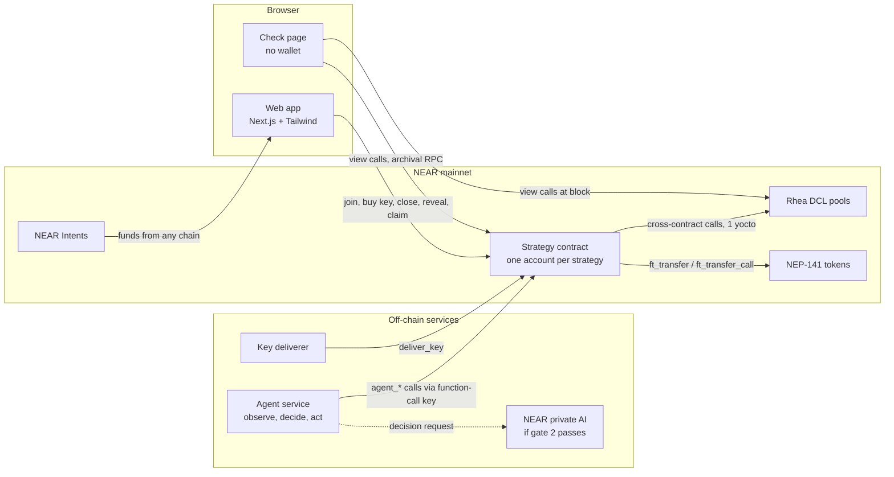
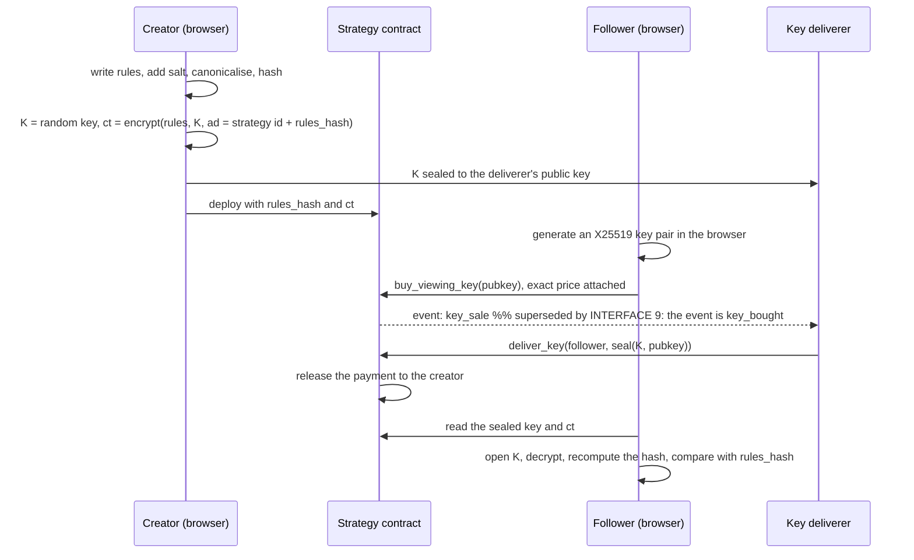

# Poolside on NEAR: architecture

Written 5 November 2026 for the NEAR hackathon entry described in [`build-brief.md`](build-brief.md). It turns the brief into components, interfaces and data formats that the team, and Claude Code, can build against.

Revision 8, 6 November 2026, after seven design audits (`docs/security/audits/`) and the gate 3 Rhea sandbox run. Nothing here has been built or tested yet. Items marked **Verify** depend on behaviour of Rhea, NEAR Intents or NEAR's private AI that we have not confirmed. Each one is tied to a gate in the brief, and the [development plan](DEVELOPMENT_PLAN.md) schedules a spike to answer it before code depends on it.

## 1. What the system must do

From the brief, the demo has to show five things on mainnet:

1. A live strategy with public profit and loss, hidden rules and real fees.
2. A follower buys a viewing key and sees the rules and position.
3. The agent tries an action outside the public limits, and the contract refuses it.
4. The creator closes the strategy, and the fee split settles on a NEAR contract with exact amounts.
5. A stranger opens the check page with no wallet and sees each action matched against the revealed rules.

Every design choice below is judged by whether it makes one of these five steps real, checkable and simple.

## 2. System overview



| Component | Lives in | Language | Owner role |
|---|---|---|---|
| Strategy contract | `contracts/strategy` | Rust, `near-sdk` 5.x | Contract |
| Rules library | `packages/rules` | TypeScript | Agent |
| NEAR client | `packages/near` | TypeScript, `near-api-js` | Contract |
| Agent service | `apps/agent` | TypeScript (Node 24, required by the NEAR AI SDK) | Agent |
| Key deliverer | `apps/deliverer`, on its own host with its own account | TypeScript | Payments |
| Alerter | `apps/alerter`, read-only, no NEAR keys | TypeScript | Lead |
| Web app and check page | `apps/web` | Next.js, Tailwind | Front end |
| Scripts | `scripts/` | TypeScript, shell | All |

The rules library is shared by the agent, the web app and the check page, so the code that decides an action and the code that checks it are the same code. This is the most important structural decision in the repo.

## 3. Repository layout

```
poolside-near/
├── CLAUDE.md                 # how Claude Code works in this repo
├── AGENTS.md                 # points other coding agents (and AI judges) at CLAUDE.md
├── README.md                 # judge-facing: problem, NEAR role, do X see Y, claim table
├── docs/
│   ├── build-brief.md
│   ├── ARCHITECTURE.md       # this file
│   ├── DEVELOPMENT_PLAN.md
│   ├── gates/                # one file per gate with the evidence and the answer
│   └── one-pager/
├── contracts/
│   └── strategy/             # Rust contract, near-workspaces tests in tests/
├── packages/
│   ├── rules/                # schema, canonical JSON, hash, encrypt, evaluate
│   └── near/                 # typed contract client, RPC helpers, Rhea views
├── apps/
│   ├── agent/                # agent loop, signer, decision log
│   ├── deliverer/            # viewing-key delivery, separate host
│   ├── alerter/              # read-only watcher, Telegram alerts
│   └── web/                  # Next.js app, including /check/[strategy]
├── scripts/                  # deploy, demo runner, dry:true quotes, fee report
├── .claude/
│   ├── agents/               # subagents: security-auditor, test-auditor, contract-reviewer, rules-verifier, claims-checker
│   ├── skills/               # poolside-brand, near-contract, rhea-dcl, demo-runbook
│   └── settings.json         # permissions and hooks
└── .github/workflows/ci.yml
```

Tooling: `pnpm` workspaces for TypeScript, a Cargo workspace for Rust, `cargo-near` to build reproducible contract WASM, `near-workspaces` (Rust) for sandbox tests, `vitest` for TypeScript tests, and `near-cli-rs` for manual calls.

## 4. The rule format

The check page depends on rules a machine can evaluate, so free text is ruled out. Version 1 is deliberately small: one pool, one range position, four decisions (`hold`, `open`, `close`, `done`; D47). **Every number is an integer** (basis points, seconds, smallest token units), so the agent, the check page and the contract tests all compute exactly the same thing (audit M5).

```jsonc
{
  "version": 1,
  "pool": "usdc.example.near|wrap.near|2000",  // Rhea DCL pool id: sorted token ids, then fee tier (gate 3)
  "quote_token": "usdc.example.near",            // unit for value, P&L and the split
  "range": {
    "width_bps": 800,                            // total range width around the centre, in DCL points (one point is a 0.01% price step, about 1 bps)
    "centre": "mid"                              // "mid" = the reference price when the range is set
  },
  "take_profit_bps": 300,                        // close when fees earned reach 3% of principal
  "stop_loss_bps": 1000,                         // close when value falls 10% below principal
  "close_after_s": 432000,                       // close this long after start; must end before the public run_end
  "salt": "AAAAAAAAAAAAAAAAAAAAAAAAAAAAAAAAAAAAAAAAAAA="  // base64 of 32 random bytes, stops dictionary attacks on the hash (this all-zero example must never be used)
}
```

`packages/rules/test/schema.test.ts` parses this example exactly as written here, with the comments removed. v2 adds a `rebalance` field (`trigger`, `edge_bps`, `min_interval_s`); v1 refuses it as an unknown field (D47, EC-R29).

Format rules:

- **Canonical form.** Rules are serialised with JSON Canonicalization Scheme (RFC 8785) before hashing or encrypting, so the same rules always give the same bytes. The value domain is deliberately stricter than RFC 8785: only safe integers (no `1.0`, `1e2` or `-0`), duplicate keys refused, input at most 4 KB.
- **Commitment.** `rules_hash = sha256(canonical_json)`. The salt is inside the JSON, so the hash reveals nothing until the reveal.
- **Schema.** The validator in `packages/rules/src/schema.ts` is the source of truth (no separate JSON Schema file). It rejects unknown fields, missing fields, non-integer numbers and out-of-range values. The contract checks only the hash, never the content.
- **Deterministic swap step (D27, D29).** The rules say where the range goes; the library says exactly how to get there. Before an open (in v1, by a separate `agent_swap`, D47), the contract swaps `swapForRange(holdings, need, observed point)` (a fixed formula in `packages/rules`, mirrored in Rust; amounts are u128, intermediates need 512-bit integers) so the holdings match the range's token ratio, then adds everything it holds. `need` is the pair of token amounts DCL's `predict_add_liquidity` gives for the target range. **Open (swap audits of `a07aa2e`):** the contract must obtain `need` itself, at a fixed large probe liquidity and a stated block, and record holdings, `need` and the probe in the ActionRecord so the check page can recompute the swap; and the swap step conflicts with `max_swap_value` and `max_value_moved_per_24h`, which are far below the roughly 50% swap a one-token start needs. Both are settled in the contract-section rewrite. The agent passes no size or amounts, but its observed point (anywhere within `max_observation_drift_bps` of the contract's reference) places the range, and the range sets `need`. With a drift above half the range width, the range can sit wholly above or below the reference, `need` becomes one-sided and the swap converts all of one token (security re-audit of `5b2ffec`, M-1); even at a fixed `need` the swap moves by up to a quarter of the drift as a share of holdings. The contract never sees the rules (only their hash), so it can't check width or centring against them; a hostile agent could submit any range of at least the minimum width with the reference at its edge, making `need` one-sided (security re-audit of `6decefb`, M-1). **Required in the contract design, all mandatory.** Drift `D`, widths and margins are all in DCL points (one point is a 0.01% price step; the rule format and `packages/rules` treat `width_bps` as points), `d` is the pool's point spacing, and `W = right - left` is the submitted range's width. The rules library accepts only the exact `targetRange(observed point)` (EC-R22), which keeps the reference at least `floor(width_bps / 2) - D` points from each edge. (1) At start, for **every** allowed pool with its own `d`: `2 * D + d <= floor(min_range_width_bps / 2)` (EC-C56; EC-C94 is retired). (2) Every open or rebalance range must contain the contract's own reference point `ref` as well as the observed point (EC-C95). (3) **Centring as a share of the submitted range:** `min(ref - left, right - ref) >= floor(W / 4)`. With (1), every range the library accepts passes; a range with the reference in its outer quarter can't, so `need` is never close to one-sided (EC-C96). (4) **Swap step caps:** one swap step never swaps more than `max_swap_step_bps` of the value held, and the shares of all swap steps in any rolling 24 hours, each taken as swapped value over value held at its own step in basis points rounded up, never total more than `max_swap_step_24h_bps` (EC-C97, EC-C98). This bounds churn per day, not per run. The contract never sees the hidden `close_after_s`, so the per-run bound uses public values only. **Every agent method that can cause a swap step (`agent_swap`, `agent_open`) is refused when `now >= run_end_ns`**, so the window is `[start, run_end)` whether or not anyone calls `close` (EC-C99). Within it, a compromised agent can push up to `ceil((run_end - start) / 86400 s) * max_swap_step_24h_bps` of the largest value held through the pool, each step losing at most `max_slippage_bps` plus the pool fee. This bound **must be stated in the README** (claims-checker item, EC-W17). The swapped amount is valued rounded **up** and the value held rounded **down**, both at the reference point, so rounding never lets a swap past the cap. (1) to (3) keep the reference in the middle half of any range; (4) bounds what swaps can move per step and per day. Re-audit history: `6decefb` M-1, `2643df5` M-1, `d473dcd` M-1 and L-1. Whether to size the swap at the reference point is open question 8. Any other swap is outside the rules.
- **Reading actions and records (EC-R25).** The agent and the check page read every action from text through `readAction` / `withinRulesText` in `packages/rules` (a wrapper over `strictParse`), never `JSON.parse`: plain integer tokens only, no `-0`, fractions, exponents, lone surrogates or duplicate keys. `ActionRecord` encodes every u64 (timestamps) and u128 (amounts) as a decimal string, read with `readU64` and `readU128` (a Rust reader must fully match ASCII digits `0|[1-9][0-9]*` before `str::parse`, which accepts `+5` and `007`; note that `$` in Python `re.match` or PCRE also matches before a trailing newline), so no record number exceeds 2^53; timestamps become `MarketState` seconds only through `nsToS` (floor). The check page parses each record on its own, not the whole view response; `withinRulesText` returns `unreadable: true` for text it can't read, which the page shows as "can't check this action", never as matching or as outside the rules; an unreadable decision record the agent committed to by hash is **not matching** (the agent reads its own text before committing), while an unreadable contract-written action record makes the run **unverifiable**; any not-matching finding beats unverifiable, which beats matching (EC-W18). The check page judges every action from the contract-written fields. A missing or tampered decision record, whose hash doesn't match, is still "not matching" (EC-W05). **Guess, to check when the record is designed:** that a full `ActionRecord` fits in `MAX_JSON_LENGTH` (4096 UTF-16 code units); if not, the limit is raised for records or the record split. **Contract arguments (unverified, to settle in the contract design):** near-sdk parses arguments with `serde_json`; deserialising straight into integer-typed fields of a `#[derive(Deserialize)]` struct with `deny_unknown_fields` refuses the same spellings (checked in `serde_json` 1.0.154: `-0`, fractions and exponents become floats, which integer fields refuse, and leading zeros are invalid), but with different error codes. Never go through `serde_json::Value`, `f64`, `#[serde(flatten)]` or an internally tagged enum (`#[serde(tag = "kind")]`), which buffers through serde's own content type and has known limits with `deny_unknown_fields`; the contract tests run every case in `number_spellings.json` through the real entry point.
- **Observed price (D28).** Ranges and swap sizes are computed at the agent's observed point. The contract checks that its own reading is within `max_observation_drift_bps` of that point and refuses otherwise; the check page judges every action at the observed block.
- **Discretion.** The rules define an allowed envelope, not a single answer. The check page marks each action as **within the rules** or **outside the rules**. It doesn't claim it would have chosen the exact same action.
- **Public limits come first.** The public limits (section 5.3) are visible from the start and enforced by the contract. The rules can only be narrower. A rule that asks for something outside the public limits is simply never executable.

`packages/rules` exports pure functions, with no clock, network or randomness inside:

| Function | Used by |
|---|---|
| `canonicalize(rules)`, `hashRules(rules)` | Web (create), contract tests, check page |
| `encryptRules(rules, key, nonce, strategyId)`, `decryptRules(blob, key, strategyId, rulesHash)` | Web (create, view). The caller supplies a fresh CSPRNG nonce; blob = version ‖ nonce ‖ ciphertext; associated data = version ‖ rules_hash ‖ strategy id |
| `evaluate(rules, state) -> Decision`, `requiredAction` | Agent (decide), check page (replay and sampling) |
| `valueInQuote`, `priceQ128` | Agent, check page: the only valuation code, in exact fixed-point integers |
| `withinRules(rules, stateBefore, action) -> Verdict` | Agent self-check before sending, check page |
| `split(balances, fees_collected, principal, shares, fee_config) -> Payouts` | Contract tests (same vectors), check page |

`split` is the **one normative formula** for payouts (section 5.10). It is written once the pooling decision is made.

**State inputs (`MarketState`).** Both the agent and the check page build the state from the same public data, by these definitions (from the rules-verifier audit):

| Field | Definition |
|---|---|
| `nowS` | Timestamp of the observation block (agent) or sample block (check page), in seconds, rounded down. Never a wall clock |
| `startedAtS` | Timestamp of the block that included `start`, in seconds |
| `point` | DCL `current_point` of the rules' pool at that block. Used for range decisions |
| `valuationPoint` | **Shipped (Q15 provisional, no anchor):** the pool's spot `current_point` at that block, the same as `point`. Holdings and fees are valued there. A one-block spot move is not the defence: a close needs two confirming observations (D53, `confirmFromBlock`, the dense-grid replay). Whether to add a public anchor is **Q15, still open** |
| `lastRangeSetS` | Timestamp of the result block of the strategy's last successful add (in v1 the open), or null. For a position the creator adopted after a lost add, the block of the Adopt record |
| `position` | The strategy's own position: the contract's `own_position`, filled by its own add, or by the creator's `adopt` after a lost add (5.2 principle 7); null if none. Other gifted positions never count |
| `closedBy` | Set only from a decision record whose kind is `close` (not inferred from the shape of action records, so a rebalance whose add failed never counts); the outcome then latches (no reopening) |
| `principal` | Quote-token units deposited |
| `holdings` | Everything the strategy holds, split into quote and base token, read live while the strategy is quiet (no lock, no unresolved `unknown_add`, and at or after `settle_until_block`; `is_quiet()`): its wallet balance plus its DCL internal balance minus the platform's owed amount (at least 0), plus what `predict_remove_liquidity` gives for its own position (D37, D38). Plain token donations count (disclosed, T65); gifted positions, lost and found and positions in other pools never do |
| `fees` | Fees earned: collected plus `unclaimed_fee_x/y` on its position, split into quote and base |

**Valuation.** Base-token amounts are converted to quote units at `valuationPoint` (see the open question under H-1 in `audits/2026-11-06-code-rules-1.md`) with `priceQ128`: price = token_y per token_x = 1.0001^point (gate 3), computed in Q128 fixed point by binary exponentiation with every product floored, for points 0 to 800,000 only (at or below the true price, within 2.1e-33 relative). Negative points are never turned into a reciprocal price, which would lose up to 3e-5 of precision; callers divide by `priceQ128(|point|)` instead. `baseToQuote(amount, point, quoteIsX)` takes the effective exponent e = −point when the quote token is token_x, else e = point. For e ≥ 0 it returns floor(amount × priceQ128(e) / 2^128). For e < 0 it returns floor(amount × 2^128 / priceQ128(−e)), dividing by the positive-exponent price instead of multiplying by a quantised reciprocal, so precision holds at very negative exponents. Because priceQ128 is itself floored, the multiply path is at or below the exact floor and the division path at or above it, each within 2.2 × 10^-33 relative plus one unit (a few units at about 10^36, and up to a few thousand units near `u128::MAX`; property-tested against the exact rational price in `price.test.ts`); the Rust contract mirrors these two paths exactly, so both sides agree. The pinned vectors in `packages/rules/test/price.test.ts`, including division-path vectors, are shared with the Rust tests.

**Decisions and action records.** In v1 (D47) `open` maps to up to two operations under one decision hash: a Swap (`agent_swap`, only if the swap step is not zero) and then an Open (`agent_open`, deposit and add, no swap), each with its own record; the Open is judged at its own observation (its range is `targetRange` of the Open's `observed` point), and the pair counts as one decision if the Open starts within `PAIR_WINDOW_S` (1 hour) of the Swap's result; `rebalance` is refused in v1, and **v1's rule schema has no `rebalance` field** (refused as an unknown field, so revealed rules never show a policy v1 can't carry out; rev 22 security M-2, contract L-4); the `packages/rules` change is its own pull request, EC-R29; `claim_fees` is refused in v1 (5.5); `close` to RemoveLiquidity of the position with no add after it. `hold` and `done` produce no record. A close condition can't be answered with any action other than the close, except that a stop loss or take profit first waits for its confirmation (5.2 principle 6, EC-R30), during which `hold` is the only answer, and the close reason must be the first condition that holds (time, then stop loss, then take profit). The contract implements it in Rust, and both sides are tested against the same vectors (audit M6).

## 5. Strategy contract

Revision 27, 9 November 2026 (D37, D38, D40 to D52). **This is the cleared design (D16, D52)**: open Medium and Low findings are tracked as edge cases and 5.11 items, closed by tests and code audits, not by further revisions. Revisions 10 to 12 kept a per-token ledger (`held`, `pending`, reconcile) so the contract could tell its own tokens from donations; each failed its design audit on that ledger (`docs/security/audits/2026-11-07-design-rev10.md`, `-rev11.md`, `-rev12.md`). Version 1 is **funded by the creator alone** (D31), so the only split is the platform's 5% of fees against everything else, and revision 13 dropped the ledger: **the contract keeps no token balance of its own and reads live balances whenever it needs one.** Revision 14 fixed the audits of revision 13 (`-rev13.md`): it tracks the **position** the strategy itself created, by `lpt_id`, so gifted positions never count, never block settlement and never size a trade. Revision 15 fixed the audits of revision 14 (`-rev14.md`): **the contract never reads `list_liquidities`** (its size is set by whoever gifts positions), and "quiet" is contract state, not a block count. Revision 16 fixes the audits of revision 15 (`-rev15.md`): lost adds are resolved by reading DCL's internal balance, then by the creator naming the position or by expiry; payout confirmation has a defined baseline and an expiry; one rate-limit key everywhere. Revision 17 fixes the audits of revision 16 (`-rev16.md`): payout confirmation counts only what arrives, with at most one expectation per token and that token's outflows refused while it is open, and `withdraw_asset` carries none; the lost-add comparison is exact; the creator can dismiss a lost-add record; every record of a call that doesn't trade goes to the preallocated ring. Revision 18 fixes the audits of revision 17 (`-rev17.md`): **balance-based payout confirmation is gone**, because each version of it let an outsider hold the strategy not quiet or stop an exit (rev 17 security H-1, contract H-1); the strategy is instead not quiet for a fixed `PAYOUT_SETTLE_BLOCKS` after each of its own payout-producing callbacks, which no outsider can start or extend; records the check page needs stay in `actions`. Revision 19 fixes the audits of revision 18 (`-rev18.md`): every resumed round re-reads the pool and repeats the drift and centring checks, so a scheduled resume can't be used to trade at a moved price; exits, settle and claims never wait on storage; the storage reserve is sized from deploy; a lost add or remove is classified only after a second read; the agent and the check page confirm off-chain that the last operation's receipts are final. Revision 20 fixes the audits of revision 19 (`-rev19.md`): an own position that has vanished is cleared wherever it is read, so settlement can't be blocked by it; resumed rounds value the add and the deploy cap at round 1's reference; a resumed risk-adding stage is refused after `run_end`; the waiting state between the two stale reads can't be aborted; every call that releases a lock is exempt from the storage check. Revision 21 fixes the audits of revision 20 (`-rev20.md`): the off-chain receipt check walks each operation's whole receipt tree from its transaction; the drift limit may not exceed the slippage limits, and add amounts come from a predict at the current point; `get_liquidity` of a removed position is confirmed to return `null` (gate 3), so the panic branch is gone; `remove_in_flight` stays open until its position is found gone. **Revision 22 narrows v1 (D47, Erik's choice): no rebalance.** A run opens one position and later closes it; the rules already latch after a close. Because a one-token start still needs a swap, an `open` decision is carried out as two separate agent calls, `agent_swap` and then `agent_open` (deposit and add, no swap), each starting from the full first checks. **No operation parks to wait for a settle window any more**, so the resumed-round checks, the window parks and most of the continuation budget go away; a chain parks only when it runs short of gas. Rebalance is a v2 item. Revision 23 fixes the audits of revision 22 (`-rev22.md`): the single open latches only on a successful add, so a refused or failed open can be retried; each operation's transaction is found by its signer, which also covers a call relayed through the caller's own contract; at most two swaps per run; the paired open is exempt from the action interval within `PAIR_WINDOW_S`; the add's predict must use nearly all of `add_amounts`, a check that doesn't depend on receipt ordering. **Revision 24 drops the off-chain receipt walk (D49, Erik's choice)** after it was the High finding in four audit rounds in a row: the agent and the check page use the on-chain settle window plus a fixed off-chain margin, and nothing an outsider sends can stall them or hide a verdict. Revision 25 fixes the audits of revision 24 (`-rev24.md`; the first round with no Critical or High from the security audit): the contract itself enforces the margin on the agent's trading calls; a stop loss or take profit must hold at two observations a margin apart (a `packages/rules` change); the swap floor's conversion and the add ratio bound are corrected; the direct-call rule is dropped, since nothing depends on it. Revision 26 fixes the audits of revision 25 (`-rev25.md`): a close's confirmation is two consecutive agent observations within a bounded span, the first one carried in the call and checked by the contract; the conversions use 512-bit intermediates and saturate; the drift bound is `3 × min_width / 32` (corrected by D54); a gap caused by a lost operation is "could not act"; one helper sets the payout window and its caller class. Section 4 states the requirements this section implements. It builds on gate 3 part C (`docs/gates/3-rhea-and-access-keys.md`). Items still open are marked **Open** and listed in 5.11; nothing here is built yet, and the M1 interface pull request freezes the signatures only after 5.11's blocking items are settled.

What gate 3 part C established and this design relies on: a payout DCL reports is not proof of arrival; a failed payout to a registered account goes back to its DCL internal balance, while one to an unregistered account becomes lost and found that only DCL's owner can withdraw; a refused swap reports `"0"` used; add refunds are paid to the wallet; gifted positions take the receiver's DCL liquidity slots; swap gas grows without bound with small positions in range; DCL storage NEAR can't be taken back.

### 5.1 One account per strategy

Each strategy gets its own NEAR account (D6), for example `s-<id>.<team-account>.near`, running the same contract code. Rhea positions belong to an account, so separate accounts keep strategies apart, and a bug or stuck position affects one strategy only. Deployment is a reviewed script that a person runs (`scripts/deploy-strategy.ts`).

### 5.2 Design principles

1. **The agent supplies choices, never trust.** The agent sends range points and a decision hash. The contract checks them against its own reads and the public limits, sizes the swap itself, builds every Rhea message itself and computes every minimum itself. The agent never passes amounts (D29).
2. **Lock first, then call out; every callback is tied to its operation.** Before any external call a method takes the operation lock `lock = Some(op_id)` and reserves its share of the caps. Every callback is `#[private]`, carries `(op_id, stage)`, and acts only if `lock == Some(op_id)` and the stored stage matches; otherwise it does nothing. A callback that would start a **risk-adding** stage (swap, deposit, add) re-checks the status, `paused` and, for `agent_swap` and `agent_open`, `now < run_end_ns`; if any fails it records the stage reached and stops. **Recovery stages** (withdrawing after a failed add) run whatever the pause and deadline.
3. **One external operation at a time,** including outsider exits, settlement, cleanups and claims.
4. **No swaps at the exit, payouts in pool tokens (D13).**
5. **Anyone can move the strategy forward after public deadlines,** but outsiders never trade. A call with nothing to do is refused at its first check, without taking the lock, from cached state. **One rate-limit rule for every method that takes the lock without trading** (`exit_remove`, `exit_withdraw`, `cleanup_gift`, `settle`, `resolve_stale`, the claims, `adopt`), and to `dismiss_unknown_add`, which takes no lock but does take the storage check of 5.3: one call per `min_action_interval_s` per (method, token, caller class), keyed on (method, caller class) for methods with no token argument; the classes are outsiders (everyone but the creator and the agent, the platform account and the deliverer included), the creator and the agent, so no class can use up another's slot (rev 15 security M-3, contract M4; rev 16 security L-4). These calls never count toward `max_actions_per_24h`. One outsider can take the outsiders' slot of a method at every interval, for example with `cleanup_gift` of a non-gift; the creator's and the agent's slots remain (disclosed, rev 16 security L-7). Token arguments must be one of the pool's two tokens, checked in the order below. Trading calls (`agent_swap`, `agent_open`, `agent_close_position`) are bounded by `max_actions_per_24h` and the action interval instead. **Every role check uses `predecessor_account_id`, never the signer**, so a contract that a role holder calls can't act as that role, and a contract configured as the role (a multisig creator) can (rev 25 test B1). **First checks run in one order for every method:** status, then caller, then `paused` where it applies to that caller (it stops only the agent's trading and exit calls, 5.4), then a token argument, then time, then no lock, then the rate limit and interval (for `agent_open`, whether it is a paired open is decided first, so the exemption applies), then the method's own checks (rev 22 test F2, rev 23 contract L-3, security L-4, rev 24 contract L-4, security L-4, test F4, F5). Revision 22's direct-call rule (predecessor = signer) is dropped in revision 25: no check depends on finding a call's transaction any more, and it only shut out multisig, DAO and NEP-366 users (rev 24 contract L-3, security L-1).
6. **No token ledger: live balances only (D37).** Per token, at a read:
   - **spendable** = wallet balance (`ft_balance_of`) plus the DCL internal balance (`list_user_assets`), minus `platform_owed` (held back for the platform from both, 5.10), at least 0;
   - **holdings** = spendable plus what `predict_remove_liquidity` gives for `own_position`, if any.

   Decisions use holdings; swaps, deposits and adds are sized from spendable only (rev 13 contract H2). Every check and every payout reads these when it needs them, so nothing drifts out of step with the chain and nothing is stranded by a lost callback. Plain token donations land in the wallet and count (T65): they can move a decision only within the public caps, and they only add to what the creator receives. **Holdings are defined only while the strategy is quiet**, which is contract state: no lock held, no unresolved `unknown_add`, and the current block at or after `settle_until_block` (rev 15 security M-2). **The settle window** (D43, rev 17 security H-1, contract H-1): every callback of the strategy's own call that makes DCL or a token pay the strategy, or moves its tokens between DCL and the wallet, sets `settle_until_block = max(settle_until_block, block + PAYOUT_SETTLE_BLOCKS)`. Those callbacks are: a remove of `own_position` (success, or found gone), a swap with `used > 0` (its output), an add, successful or failed (its refunds), a deposit (its unused amount) and `withdraw_asset`, `true` or `false`; `StaleRead` sets it too for a lost remove, swap, add, deposit or withdraw, at the block of its callback, and so does the `StaleConfirm` callback of the second read (rev 19 contract L-1). **No operation waits for the window inside itself** (D47): an operation's first check requires quiet, so `agent_open` can't start until the swap's window has passed, and the add follows its own deposits directly, because it uses only the internal balance and a deposit's unused amount goes to the wallet. A gift's removal by `cleanup_gift` sets nothing: its proceeds are a donation, and a donation landing late can only raise holdings. So only the strategy's own operations start the window, at most once per callback (every update is a `max()`), and no outsider can start or extend it except through calls the rate limit already bounds: an outsider's `exit_remove` or `exit_withdraw` after `run_end + exit_grace`, `resolve_stale` of an own operation already in flight (rev 18 security L-2), and a `settle` or other read that finds the own position gone (principle 7), once per own position (rev 20 test F1). A gift's payout that fails and bounces into the internal balance a block later is the one movement no window covers; `cleanup_gift` therefore sets `gift_settle_until_block` (`OFFCHAIN_MARGIN_BLOCKS` long, since a bounce can be as late as any payout; rev 25 contract L-4), which only `agent_swap` and `agent_open` wait for at their first check (`LIMIT: gift settling`), so `internal_before_add` is never read while a bounce can land; it doesn't affect quiet, exits or claims. One outsider can delay swaps and opens this way by `OFFCHAIN_MARGIN_BLOCKS` per `min_action_interval_s` (disclosed, rev 18 security L-3, contract L-5). There is no expected amount, no baseline and no inbound counter to forge. `PAYOUT_SETTLE_BLOCKS` is a measured constant, proposed 20, at least the most blocks seen between a callback and its payout, including a failed payout returning to the internal balance (gate 3 part C saw one block); **Open**, measured on mainnet and in the sandbox (5.11). **The margin** (D49, D50): a block counts as settled for a decision only if it is at least `OFFCHAIN_MARGIN_BLOCKS` (2 × `PAYOUT_SETTLE_BLOCKS`) after the last own payout-producing callback, which the contract stores as `last_payout_callback_block` together with `settle_window_class`, the caller class of the operation that caused the payout (for a `StaleRead` or `StaleConfirm`, the lost operation's class, not the resolver's). Every callback that sets `settle_until_block` goes through one helper, `set_window(block, class)`, which sets all three, so they can't diverge (rev 25 security L-2, contract L-7). **The contract enforces it** on `agent_swap`, `agent_open` and `agent_close_position`: refused `LIMIT: inside payout margin` unless `observed.block >= last_payout_callback_block + OFFCHAIN_MARGIN_BLOCKS` (exits, settle and claims keep the 1× window), so no agent action can be observed inside it (rev 24 security M-2, contract M-3, test B1). The check page reads the archival `get_last_payout_callback_block()` at each sample block, never the ring (rev 24 security L-3, test F3), and judges a sample at the next block at or after the margin. There is no receipt walk and no transaction search, so no call by anyone can stall the agent or hide a verdict. A gap that this leaves without a settled block is judged by who caused it: "not matching" when the creator or agent held the lock or set the window (`settle_window_class`), "could not act" when outsiders did, and "could not act" when the lock was held only because an own operation was lost (waiting for `resolve_stale`, or in `StaleRead` or `StaleConfirm`), unless the agent or creator left it unresolved more than `stale_after_blocks` plus one sampling interval after it became resolvable (rev 24 contract L-1, rev 25 security M-2). `get_settle_window()` returns `(last_payout_callback_block, settle_window_class, settle_until_block)` for the page's archival reads (rev 25 security L-1, test F2). **A payout later than the margin** (a heavily congested shard) can understate holdings for a moment. So that neither the agent nor the page acts on such a moment, a stop loss or take profit is **confirmed**: it must hold at the agent's observation `O1` and at every agent observation after it up to `O2`, with `OFFCHAIN_MARGIN_BLOCKS <= O2 - O1 <= CONFIRM_MAX_BLOCKS` (10 × `OFFCHAIN_MARGIN_BLOCKS`, a fixed constant, not measured); a false reading in between restarts it, and a change between conditions doesn't, since the contract can't see the reason (EC-R30, D53). **Every** `agent_close_position` carries `confirm_observed { block, point }` (`O1`) besides `observed` (`O2`), the time condition included (it only delays a time close by the margin), because the contract can't see which condition fired (rev 26 security M-2, contract M-1, test B1). The contract checks `O1 <= O2` first and then `O1 + OFFCHAIN_MARGIN_BLOCKS <= O2 <= O1 + CONFIRM_MAX_BLOCKS` with checked additions (`LIMIT: confirmation span`, never an underflow), requires `O1 >= quiet_since_block` and `O1 >= last_payout_callback_block + OFFCHAIN_MARGIN_BLOCKS` (`LIMIT: observation not quiet`, `LIMIT: inside payout margin`; rev 26 security M-3, contract M-2), checks `confirm_observed.point` as a point (principle 10), and records both in the ActionRecord (`confirm_observed`). The page re-evaluates the condition at both recorded blocks against archival reads (a close is "not matching" when `checkConfirmation` refuses it: some close condition, or the latch, must be due at `O1`, at `O2` and at exactly the heights of the fixed grid `confirmGrid(O1, O2)` (every multiple of `DENSE_STEP_BLOCKS` in between, all settled there; a height with no block has the state after the latest block below it, so nothing throws if NEAR skips heights, which a scan of 2,000 consecutive mainnet heights didn't find, `docs/gates/3`), checked at `O1` and `O2` first; the agent carries its confirmation over the same grid states and its own observations off the grid count for nothing, so the agent and every page judge the same blocks and the agent can't choose which readings count; the reason is the one due at `O2`, EC-W22), and detects a missed close by **dense sampling** with **no excuses** (D53; rev 26 security H-1, contract H-1, rules re-audit security H-1): when any sample shows a close condition due with a position held, the page samples every `DENSE_STEP_BLOCKS` (`OFFCHAIN_MARGIN_BLOCKS / 2`), also backward to the previous base sample, until the condition is no longer due or the agent's successful close lands. A stretch ends only on a market fact: no close condition due (a change between conditions continues it, reported as the one due at its end), the position gone, or the agent's successful close. Nothing anyone sends ends it: not a lock, a pause, a refused or failed close, an action of the agent or a gap between samples, so no helper of the agent's can reset it. The samples are the grid states only, one per `DENSE_STEP_BLOCKS` window at its `gridPoint` (a window with no quiet, settled height gives no sample, a gap, which never ends a stretch; a stretch followed by gaps is measured to the next sample or to the end of the range the page judged, so locks that leave no samples can't cut it short; when the agent could first act inside any gap of more than one window, trailing or inside the stretch, the page also reads the last block before that moment and the first block at or after it, at adjacent heights, and the allowance counts blocks from the second and seconds from the moment, `MissedCloseLimits.clock`; a height skipped between the two is "can't check"; clock points, samples and the end of the range must agree on every block's timestamp), and each successful close's `O2`; the agent's own observations are never samples. A stretch is judged from the first sample at or after the later of its start and when the agent could first act (its last `agent_swap` or `agent_open` lock at or before the stretch's first sample plus `min_action_interval_s`, which in v1 can only happen while no position is held, and when the 24-hour count, close attempts included, frees a slot if it was full; a close attempt never moves this point), and is a missed close (or a late close, when the agent's close lands after it) once it is held past that by more than `CONFIRM_MAX_BLOCKS + max_observation_age_blocks` blocks **and** `MISSED_CLOSE_GRACE_S` (three observation periods, 180 s) in block timestamps, so the units never mix and an honest agent waiting out its interval is never blamed. Locks, pauses and outsider calls in the stretch are shown beside the verdict as context; an honest agent held out for long by outsiders can be blamed, which the generous allowance and the shown context answer (disclosed, T71). A single true sample alone is "can't check". `missedClose` and `checkConfirmation` in `packages/rules` are the one implementation (rules re-audit M-1, M-2, test M-1 to M-4). Confirmation delays a stop loss by at least the margin after it first holds, so in a fast fall the realised loss can pass `stop_loss_bps` (T69, disclosed; rev 25 security L-6). A close that still fires on a late payout latches and ends the run (T69, disclosed). `quiet_since_block` is the first block of the current quiet stretch, the latest of the last lock release, the last `unknown_add` resolution and `settle_until_block`; the agent's `observed.block` must be at or after it (rev 15 security M-4). `is_quiet()` computes this from stored values and the current block and writes nothing. The views `is_quiet()`, `get_quiet_since_block()`, `get_settle_until_block()` and `get_settle_window()` expose it; the check page judges each sample at the next block at or after the margin (EC-W21).

7. **The strategy's position is the one it created.** `own_position` holds the `lpt_id` its own successful add returned (at most one), or one the creator adopted after a lost add. **`opened`** is set when an add's callback returns an `lpt_id`, when `adopt` succeeds, or when a lost add is recorded as `unknown_add`; it is cleared again only by `dismiss_unknown_add`, at most once per run (a second dismissal leaves it set; rev 23 security L-1, contract L-1, test B1). A refused or failed open, or a lost add classified as failed, leaves it unset, so the agent may retry (rev 22 security H-1, contract H-1). Only it counts in holdings, earns `fees_collected`, is closed by the agent, and can hold up settlement. Any other position the strategy owns in its pool is a **gift**: it never counts, never blocks anything, and anyone may remove it with `cleanup_gift` (its proceeds land in the wallet as a donation; its fees count for nothing). Positions in other pools are never touched. **A vanished own position** (rev 19 security H-1): `get_liquidity` of a removed position returns `null`, directly and cross-contract (gate 3, sandbox, asserted). Every `get_liquidity(own_position)` read outside the stale path (a read round, an exit's pre-read, `settle`) that returns `null` or a position owned by another account clears `own_position`, adds the fees in `remove_in_flight` once if it is open for that `lpt_id` and the read returned `null` (a position now owned by someone else paid the strategy nothing, so no fees are counted; rev 21 contract L-1), writes an `OwnPositionGone` record to `actions` and sets the settle window. The operation that read it then ends: a trading call records `Refused(own_position_gone)` (counted toward the windows, lock released), an exit records its result and does nothing more, and a `settle` releases the lock without moving to `Closed`, which the next `settle` at or after the window does (rev 20 test F2, F3). **`remove_in_flight` stays open** for its `lpt_id` until a read finds that position gone or a new remove of the same position replaces it, so a remove that runs after both stale reads still has its fees counted once (rev 20 security L-1, contract L-1). In the stale path, a lost remove found gone in either read is classified by the stale rule (`StaleResolution` with the fees once), never as `OwnPositionGone` (rev 20 test F4). The read in a remove's own failure callback (5.7) is not this rule: there, gone means the remove happened, handled as a success with the recorded fees (rev 21 security L-3). A read that fails (gas or congestion, not `null`) changes nothing; three failed reads at least `min_action_interval_s` apart, counted once per interval whatever the caller class, over at least 24 hours count toward 5.8's stuck rule like failed removes (only in `Closing`). **Every stale read**, of the own position or of the balances (a lost add, deposit, withdraw or claim), follows the same three-failure rule in `StaleRead` or `StaleConfirm`: the lock is then released with the operation recorded `Unknown`; a lost add is recorded as `unknown_add { left, right }` (the conservative choice, so adopt, dismissal and expiry still apply) and a lost remove keeps the position; so a lock is never held for ever (rev 20 contract H-1, rev 21 security M-1, contract L-4, test F4). **The contract never reads `list_liquidities`**, whose size and gas anyone can raise by gifting positions in any pool (rev 14 security C1); every position read is a `get_liquidity` of a named `lpt_id`. **A lost add.** On NEAR a callback isn't dropped: it runs late, or fails for lack of gas or a panic, and callbacks here have fixed measured gas and don't panic. So a "lost" add is a late or failed callback. `resolve_stale` at the add stage moves to `StaleRead`. `internal_before_add` is the DCL internal balance of each token from the read that follows the deposits' callbacks, just before `add_liquidity` (so after the deposits). `StaleRead` reads the internal balance again, and **a second read** `stale_cooldown_blocks` later (the lock stays in `StaleConfirm` between them, and `resolve_stale` may run the second read from that block) must give the same result, so a receipt that was only slow has run by then (rev 18 security M-5). The add **failed** only if, for **both** tokens and in **both** reads, it equals `internal_before_add` exactly, and the record is then cleared with nothing adopted; if either read differs, `unknown_add` is recorded (rev 19 contract L-2, test F1). **The stale resolution is the second read**: its block and timestamp are `stale_resolution_block` and `stale_resolution_ts`, from which the stale cooldown, `ADOPT_WINDOW` and expiry count (rev 19 security L-2, contract L-3). Tokens therefore stay locked for up to `stale_after_blocks + 2 * stale_cooldown_blocks` after a lost operation (disclosed). `StaleConfirm` is not a parked chain: `abort_pending`, `set_agent` and `close()` don't end it, and they are refused with `LIMIT: stale resolution pending`; if the second read fails, the lock stays in `StaleConfirm` and `resolve_stale` may retry it after `stale_after_blocks` (rev 19 contract M-2). Any other result, lower in either token or higher in either, records `unknown_add { left, right }` (rev 16 security M-1). A successful add takes at least one token, so it lowers at least one internal balance, and a refund that bounces back into the internal balance (gate 3 part C) still leaves it lower by the used amount; when the price has stayed inside the range it lowers both (rev 17 security L-6). Two assumptions this rests on are M1 blockers (5.11): that a failed add leaves the internal balance unchanged, and that nothing but the strategy's own calls and DCL's refunds can change its internal balance. While `unknown_add` is set the strategy is not quiet. It is resolved in one of three ways:
   - **only the creator** may `adopt(lpt_id)`, checked by one `get_liquidity` read for owner, pool and points (no liquidity window, rev 15 security H-1, contract M2);
   - **only the creator** may `dismiss_unknown_add()`, for a record the creator judges false;
   - anyone may `expire_unknown_add()` once all of these hold: `now >= run_end + exit_grace`, `now >= stale_resolution_ts + ADOPT_WINDOW`, and the block is at least `stale_resolution_block + stale_cooldown_blocks`, so the creator always gets the whole `ADOPT_WINDOW` to adopt (rev 17 security L-1).

   `adopt` and `dismiss_unknown_add` are refused within `stale_cooldown_blocks` of the stale resolution, so a late DCL state is visible first. `dismiss_unknown_add` and `expire_unknown_add` are refused while the lock is held (`LIMIT: operation pending`), and `adopt`'s callback adopts only if `unknown_add` still exists and `own_position` is empty, otherwise refusing with only an event and the rate-limit stamp (no record; rev 20 test F13) (rev 17 security L-4, contract L-3). Each resolution sets `quiet_since_block` if nothing else keeps the strategy not quiet. While the record is unresolved, `cleanup_gift` refuses positions with its points. Adopting a gift at the same points, dismissing, or never adopting all turn the real position into a gift whose fees escape the platform's cut; this is bounded by 5% of that position's fees (T67, disclosed). Until it is resolved the agent can't swap, open or close, so a real position is unmanaged (T68); the check page counts that gap against the creator once it is older than `ADOPT_WINDOW` (24 hours) from the stale resolution (section 8, EC-W21).
8. **Bounded everything.** Every read round reads at most one position (`own_position`, or the one named in `adopt` or `cleanup_gift`), so gifts can't push a chain past its gas. Every method that creates a promise refuses at its first check when prepaid gas is below a measured constant (`MIN_GAS[method]`). Each stage's promise and callback get fixed gas constants (`STAGE_GAS`, `CALLBACK_GAS`), and the gas forwarded to DCL is the same whatever the caller attached. A chain starts a stage only if the prepaid gas left covers that stage; otherwise it parks (5.6). Calls whose nothing-to-do can be seen from cached state are refused at their first check without the lock; calls that need a read to find out (claims, `exit_withdraw`) take the lock and write no stored record when there was nothing to do, only an event. **Lock-taking calls that don't trade are rate-limited for everyone, the creator and the agent included**, by principle 5's one rule, so nobody can keep the strategy not quiet at will (rev 14 security H1). **Records the check page needs go into `actions`:** every trading record, and every record that changes `own_position`, `unknown_add`, `fees_collected`, `principal` or the status (Adopt, DismissUnknownAdd, ExpireUnknownAdd, OwnPositionGone, an exit or `StaleResolution` that removes the own position, settle, close), and every `StaleResolution` of a trading operation, of a lost add, or of an exit that removed the own position. A lost exit classified "present" goes to the ring with a counter, like a lost claim (rev 21 security L-2). `Aborted` is a result of the operation's own record, not a record of its own (rev 20 contract L-2). A lost claim's or `exit_withdraw`'s `StaleResolution` goes to the ring, and state keeps a counter per token with the last such block (read with `get_lost_counts()`; rev 21 test F3), so a `paid_platform` raised by a lost claim keeps its evidence without growing `actions` (rev 19 security L-7, rev 20 security L-4, contract M-2). Each of those is bounded by the trading records or happens once per run, so `actions` stays bounded (rev 17 security M-2, contract M-1). The `Settle` record carries `remove_failures` and `withdraw_failures` as counters with the last three blocks each (so outsiders' repeated failing exits can't grow them; rev 19 contract L-9), so a settle with a stuck position or token can be checked after the ring is overwritten (rev 18 security L-4). **Claims go to the ring**: `paid_platform` and `fees_collected` are state, so no verdict needs a claim record, and repeated claims can't grow `actions` (rev 18 security M-4, contract M-2; rev 19 test B1). **Every other record, by anyone, goes into a ring of `RING_SIZE` (256) records**, allocated in full at `new`, read with `get_ring(from, limit)`: `cleanup_gift`, `exit_withdraw` and every claim that does something. A call that had nothing to do, or was refused after its read with only the rate-limit stamp changed, writes no record of any kind, only an event (rev 19 test F5). Every ring slot is allocated at the largest record size, so overwriting never grows storage (rev 19 contract L-10). No verdict depends on a ring record. So no caller can drain storage (rev 16 contract M2, L5).
9. **Pinned counterparties and code.** The DCL contract, the quote token, `wrap.near` and the fee-tier-to-spacing table (100 → 1, 400 → 8, 1000 → 20, 2000 → 40, 10000 → 200, the same table as `FEE_TIER_POINT_DELTA` in `packages/rules` and gate 3) are compile-time constants per network. The pool's two tokens come from the pool id, which `new` checks against those constants, sorted. The WASM hash must equal a reproducible build of an audited commit.
10. **Integers and hashes on the wire (EC-R25).** Arguments are deserialised into integer-typed fields of `#[derive(Deserialize)]` structs with `deny_unknown_fields`, never through `serde_json::Value`, `f64`, `flatten` or an internally tagged enum. Any integer carried as a string uses a strict newtype that fully matches ASCII `0|[1-9][0-9]*`. Hashes are 64-character lowercase hex strings.
11. **DCL registration, slots and events.** The strategy registers at DCL once with `dcl_storage` and never unregisters (DCL has no unregister; storage NEAR is not recoverable, paid by the creator and disclosed, T59). Every DCL call is refused while the registration is unconfirmed (EC-C100). No storage or slot check ever guards an exit (EC-C104). Nothing in the contract, the agent, the alerter or the check page reads an event from a failed receipt (T60).

### 5.3 State, configuration and public limits

Set once in `new`, readable by anyone, never changed later except `agent` while paused. `new` refuses anything outside the bounds (EC-C56) and limits that break section 4's cross-limits (EC-C56). `new` also refuses a `creator`, `agent`, `deliverer` or `platform_account` equal to each other, to the strategy account, to the DCL contract or to either token contract.

```rust
pub struct Config {
    creator: AccountId,                  // the only funder (D31)
    agent: AccountId,                    // only caller of agent_* methods
    deliverer: AccountId,                // only caller of deliver_key
    platform_account: AccountId,
    quote_token: AccountId,              // network constant: native USDC (D21)
    dcl_contract: AccountId,             // network constant: dclv2.ref-labs.near; `new` refuses any other value (`LIMIT: not the network constant`, rev 25 contract L-6)
    rules_hash: Hex32,
    rules_ciphertext: Vec<u8>,           // 41 ..= 4096 + 41 bytes (41 is an empty envelope: 1 + 24 + 16, `packages/rules/src/crypto.ts`)
    platform_bps: u16,                   // exactly 500 in v1 (D2)
    key_price: NearToken,                // <= 1 NEAR
    max_key_sales: u32,                  // <= 50
    key_delivery_window_ns: StrictU64,   // 10 minutes .. 24 hours
    start_deadline_ns: StrictU64,        // > now, <= deploy + 7 days
    run_end_ns: StrictU64,               // > start_deadline, <= deploy + 30 days
    exit_grace_ns: StrictU64,            // 1 hour .. 7 days
    platform_claim_window_ns: StrictU64, // 1 .. 7 days: the creator's claims wait this long for the platform's (5.10)
    stale_after_blocks: u64,             // 500 .. 10_000
    stale_cooldown_blocks: u64,          // stale_after_blocks .. 2 * stale_after_blocks (EC-C56)
    dcl_storage: NearToken,              // 2 .. 10 NEAR: (dcl_storage - 0.1) / 0.01 slots, paid by the creator
    attested: bool,                      // true only if gate 2 passes: `new` refuses true while the compile-time `ATTESTATION_ENABLED` is false (`LIMIT: attested`, D54)
}

pub struct PublicLimits {
    max_principal: StrictU128,           // 500 USDC (D4): the funding cap, and the most an open deploys (5.6)
    pool: String,                        // exactly one pool in v1: USDC/wNEAR fee 100 (D32)
    max_slippage_bps: u16,               // 1 .. 300, remove and add minimums from a predict read in the same round as the drift check (5.6, 5.7)
    max_swap_slippage_bps: u16,          // 11 .. 100 (10 is v1's pool fee of 1 bp plus 9 bp, and the drift cross-limit needs at least 1 more), swap minimum from a same-chain DCL quote; fee_bps = fee_tier / 100
    max_observation_drift_bps: u16,      // 1 .. 300 points; <= the largest D with `2 * D * W <= a * (W - a)`, `a = floor(W / 4)`, at `W = min_range_width_bps` (`max_drift_for_width`), so ADD_RATIO_BPS <= 5_000 at the centring limit for every accepted range (the earlier `floor(3 * W / 32)` let it reach 5,117 at width 75, drift 7; checked for every pair of widths by `width_bound_holds_for_every_width`; first checked 9 November 2026) (rev 24 contract M-2, rev 25 contract L-1); and <= max_swap_slippage_bps - 10 (rev 20 security M-1); checked in this order, each with its own message (EC-C56)
    max_observation_age_blocks: u64,     // 1 .. 100
    min_range_width_bps: u32,            // >= 50 points
    max_range_width_bps: u32,            // min .. 5_000
    max_swap_step_bps: u16,              // Open (Q16): one swap step as a share of holdings (EC-C97)
    max_swap_step_24h_bps: u16,          // Open (Q16): rolling 24 hours (EC-C98)
    min_action_interval_s: u64,          // 300 .. 3_600
    max_actions_per_24h: u32,            // 4 .. 48, every lock of a trading call counts, refused ones included (the honest swap and open need 2, and 4 leaves one retry each; liveness under attack is T61 and T62; rev 23 security L-5)
    dust_threshold: Vec<(AccountId, StrictU128)>,  // exactly the pool's two tokens, no duplicates, each at least 1 (`LIMIT: dust threshold zero`, D54) and <= 10^-3 of max_principal at the start price
    // Open (Q15): the anchor or a two-read check for adds, removes and stop-loss valuation.
}
```

`ActionRecord` (integers above 2^53 as strict decimal strings, hashes as hex):

| Field | Meaning |
|---|---|
| `op_id`, `index`, `kind` | Swap, Open, ClosePosition, ExitRemove, ExitWithdraw, CleanupGift, Adopt, DismissUnknownAdd, ExpireUnknownAdd, StaleResolution, OwnPositionGone, ClaimPlatform, ClaimCreator, Settle, Close |
| `caller`, `pool`, `position_id` | |
| `left_point`, `right_point` | The points sent, as used |
| `observed`, `reference` | `{ block, point }` from the agent, and from the contract's own read; `reference` per read round |
| `confirm_observed` | `{ block, point }` of the close's first confirming observation (every close) |
| `call_blocks` | The `block_height` of the call that started the operation and of every `agent_continue` of it (the check page's bounded scan for the agent's own transaction starts here, 5.3) |
| `result_ts_ns` | Timestamp of the block in which the operation's result was recorded (pairing, EC-C158) |
| `holdings` | `{ wallet, internal, platform_owed, positions }` per token, with the block of each read: what every check, the swap size and the add amounts were computed from |
| `slots` | `{ cur_liquidity, cur_order, max }` |
| `stages` | Per stage, in order: `removed { reported, minimums, fees }`, `quoted { amount_in, quote_out, min_out }`, `swapped { token_in, amount_in, used, forwarded_gas }`, `deposited { amounts, used }`, `added { amounts, lpt_id }`, `withdrawn { token, result }`, each with its result |
| `need`, `probe_amounts`, `need_block`, `add_amounts`, `add_predict`, `deploy_cap` | `add_predict` is the `need_x/need_y` of the predict read with the add's drift check, which the check page uses for what was deployed (rev 21 contract L-5); `need` is the ratio from the probe; `add_amounts = scaleNeed(need, spendable after the swap)` (`packages/rules`, shared vectors), each token capped so the add's value at the reference is at most `max_principal` |
| `decision_hash`, `chain_head`, `attestation_hash` | |
| `block_height`, `result_block`, `timestamp_ns` | |
| `result` | Pending, Ok, Failed(stage), Refused(reason) (`reason` is one of a fixed set of limit names, the same names as the `LIMIT:` messages, listed in the event and interface pull request; rev 16 contract L3), SlotsFull { cur, max }, SwapRefused { used: 0, forwarded_gas }, Aborted, Unknown (`Aborted` is always a result, never a kind) |

The contract can't see why DCL refused a swap (a callback gets only the token's `"0"`), so the check page classifies `SwapRefused` from the DCL receipt. It finds that receipt through the agent's own transaction: the agent's function-call key reaches only the strategy, so the transaction is the one signed by the agent account with the strategy as receiver, found by a scan of at most `AGENT_TX_SCAN_BLOCKS` back from the record's `call_blocks`, keeping the one whose method is `agent_swap` or `agent_continue` with the record's `op_id` and whose strategy receipt runs at `call_blocks` (rev 25 security L-5); if an RPC errors on both providers it is "can't check", and if both answer and no such transaction exists it is "not matching", because the agent controls how it signs (rev 25 contract L-5). `AGENT_TX_SCAN_BLOCKS` is measured (5.11). `SlotsFull`, `SwapRefused` and `Aborted` are never excused and never shown as "matching"; the page gives "could not act" where the cause can't be attributed, and "not matching" where the creator or agent caused it (EC-W20).

`Strategy` holds `config`, `limits`, `status`, `paused`, `principal` (funding received), `own_position`, `unknown_add` (with its stale-resolution block and timestamp), `opened` and whether a dismissal has cleared it, `swaps_used` (swaps with `used > 0`, a lost swap counted), the last trading record's kind, result, `used` and `result_ts_ns` (for pairing), `settle_until_block`, `last_payout_callback_block`, `settle_window_class`, `gift_settle_until_block`, `quiet_since_block`, `internal_before_add`, `last_inbound_block`, `remove_in_flight { lpt_id, unclaimed fees }`, `claim_in_flight { id, role, token, amount }`, `lock` (with its stage, first park block, `continue_deadline`, continuation count and the operation's cap reservation), `last_call_ns` per (method, token, caller class), the ring, `remove_failures` for the own position (deleted when it is gone) and `withdraw_failures` per token (5.8), the rolling windows, `actions`, `seen_decision_hashes`, `last_heartbeat`, `fees_collected` per token, `paid_platform` per token, `closed_at_ns`, `near_owed`, `key_sales`, `escrow_total`, `storage_reserve`, `revealed` and `registrations`. There is no token ledger (`held`, `pending`) and no `close_snapshot`.

`storage_reserve` covers contract storage: `(D + 1) * min(max_actions_per_24h, floor(86_400 / min_action_interval_s) + 1)` trading records (a rolling window allows a full batch at each day boundary; rev 19 contract L-4), where `D` is `run_end + exit_grace - now` at `new`, in whole days rounded up (`start` may come as early as deploy, and trading records can be written until `run_end + exit_grace`; rev 17 security L-5, rev 18 security M-3, contract M-1), plus a fixed 48 non-trading `actions` records (see the cost below) plus a fixed 8 for status changes, each at the measured largest Borsh size of any record kind (about 1.5 KB, to be measured in M1 and asserted in tests; rev 19 security L-5), plus the ring, allocated in full at `new`, **The NEAR this costs is the creator's** (disclosed in the README): in v1 a run has at most three own positions (the open, one adopted after a lost add, and one reopened after the single dismissal), each with at most one chain of non-trading records (`StaleResolution`, `Adopt` or a dismissal or expiry, an exit, `OwnPositionGone`); the reserve counts **one record per trading lock plus a fixed 48**, and the paired opens' interval exemption adds at most `MAX_SWAPS_PER_RUN` locks, counted in (rev 22 contract L-1, rev 23 test B1, contract L-6). At about 0.015 NEAR per 1.5 KB record it is `((D + 1) × min(max_actions_per_24h, floor(86_400 / min_action_interval_s) + 1) + MAX_SWAPS_PER_RUN + 48 + 8) × 0.015` NEAR plus the ring (256 × 0.015 ≈ 3.8 NEAR): for a 30-day run (`D` 31) at 6 a day, (192 + 58) × 0.015 ≈ 3.8 + 3.8 ≈ 7.6 NEAR; at the bounds (`D` 37, 48 a day), (1,824 + 58) × 0.015 ≈ 28.2 + 3.8 ≈ 32 NEAR. `start` requires it; reducing the record size is an M1 item. The reserve also covers key sales, the windows, `seen_decision_hashes`, `near_owed` entries and `reveal`'s 4 KB. On every write `account_balance - storage_cost >= escrow_total + near_owed_total`; every lock-taking call **except the exits, `settle`, the claims, and the calls that release a lock (`resolve_stale`, `abort_pending`, `close()`, an `agent_continue` that runs a recovery stage or records `Aborted`)** checks at its first check that the free balance, less `EXEMPT_ROOM` (16 records: at any time at most one own position and one operation in flight, whose exempt records are an exit, a `StaleResolution`, an `OwnPositionGone`, a settle and a close, with margin), covers its worst-case records (`LIMIT: storage`; rev 20 test F9). The exempt calls are never refused for storage (principle 11): their records are ring slots allocated at `new` or bounded `actions` records kept inside the reserve, so they always fit, and a stuck lock can always be released (rev 18 test B1, rev 19 test B2, contract M-1). `withdraw_storage_surplus()` returns the rest to the creator in `Cancelled`, or in `Closed` once the rules are revealed, `own_position` is empty or stuck and each internal balance is below dust or stuck (the 5.8 rules), and the strategy is quiet (rev 17 contract L-5, rev 18 security L-6), always keeping `STORAGE_HEADROOM` (0.5 NEAR) for later exits, claims and 1-yoctoNEAR deposits. Restore writes after a failed NEAR transfer are exempt from the balance check.

### 5.4 Status

```mermaid
stateDiagram-v2
  [*] --> Open: new
  Open --> Running: start (creator; funded; registered; free DCL slots; before start_deadline)
  Open --> Cancelled: cancel (creator, or anyone after start_deadline; not while locked)
  Running --> Closing: close (creator, or anyone after run_end)
  Closing --> Closed: settle (anyone; own positions gone or stuck, internal balances below dust or stuck; gifts ignored)
  Cancelled --> [*]: withdraw (creator)
  Closed --> [*]: claim, exit_remove, exit_withdraw, withdraw_storage_surplus
```



`paused` stops every `agent_*` method except `agent_heartbeat`, and the agent's own `exit_*` calls (EC-C48). The agent's `cleanup_gift` and `resolve_stale` stay allowed while paused, because anyone may make them (EC-C141). The creator and outsiders can still close, exit, settle and claim. A pause landing mid-chain stops it before its next risk-adding stage; recovery stages still run, and a chain parked before a recovery stage may be resumed by `agent_continue` while paused. Any other parked chain is ended by the creator's `abort_pending`, and tokens left in the internal balance stay holdings.

### 5.5 Methods

| Method | Caller | Rules |
|---|---|---|
| `new(config, limits)` | The strategy account or its parent, once (the parent must be a plain account, or a factory that calls `new` in the same batch it creates the account in; whoever controls the parent controls initialisation): the deploy is one batch signed by the parent (the only account that can create it): create, fund with a Transfer, add the recovery key, deploy, `new` (N4); nobody else can initialise it, and if `new` refuses the whole batch, deploy included, reverts (re-review H-1, T72); no `#[private]`, an explicit check, so the `AUTH:` message reaches the chain | In order: the caller (`AUTH: new only by the strategy account or its parent`), a sandbox build only on `.test.near` (`LIMIT: sandbox build`), prepaid gas at least `MIN_GAS_NEW` (`LIMIT: gas`), the rules hash, every bound, cross-limit and account rule (5.3), and a balance of at least the registrations' cost (both tokens' 0.00125 NEAR, `dcl_storage`) plus the storage stake of what the account already uses and a margin (`LIMIT: balance for registration`); then three registrations: `storage_deposit` with both tokens (0.00125 NEAR, their fixed bound, `registration_only`) and with DCL (`dcl_storage`). DCL's `register_tokens` is never called (gate 3: it panics `E104` and isn't needed). Each registration carries a launch nonce; its callback has fixed gas, starts no promise, records `Ok` or `Failed` and ignores a stale nonce. Events: `new`, `registration_started`, `registration`, `registration_ignored` |
| `retry_registration(target)` | Creator, `Open` | In order: status, caller, `MIN_GAS_RETRY`, then the registration: allowed when `Failed`, or when still `Pending` `stale_after_blocks` after its launch (its callback was lost), else `LIMIT: registration not failed`; the balance as in `new` for that one cost. DCL storage is only re-checked with `storage_balance_of` (no deposit) while a deposit may have landed: when stale, and after any failure that didn't show the NEAR came back. A re-check is `Ok` only if the balance's `total` is at least `dcl_storage` (an outsider can register the strategy with DCL's 0.5 NEAR minimum); a failed deposit receipt clears the flag, and a `null` or a lower total clears it only if the re-check was launched at least 2 × `stale_after_blocks` after the deposit, since the deposit may still be in flight. So DCL's storage NEAR is never paid twice; a token's retry repeats `storage_deposit`, which refunds if already registered |
| `ft_on_transfer(sender_id, amount, msg)` | Token contract | Constant cost (a measured gas ceiling), never panics, saturating arithmetic. **A predecessor other than the two pool tokens:** returned in full in every status, nothing written. **Pool tokens:** in `Open` nothing pays out from a balance read, so refunds are safe there: `principal` is credited only when the predecessor is `quote_token`, `sender_id == creator` and `msg == "fund"`, up to `max_principal`, **the excess returned unused**; every other pool-token transfer in `Open` is returned in full. A non-zero return sets `last_inbound_block` (the only case a refund is in flight). In every other status every pool-token transfer is kept (returns 0), and becomes holdings (EC-C03, rev 15 contract M3) |
| `cancel()`, `withdraw(token)` | Creator; anyone after `start_deadline` for cancel | Cancel refused while locked. In `Cancelled`, `withdraw(token)` pays the creator the whole wallet balance of either pool token, read under the lock, and only once `last_inbound_block` is at least `QUIET_INBOUND_BLOCKS` old (equal to `OFFCHAIN_MARGIN_BLOCKS`; rev 18 contract L-3, rev 24 contract L-2), so a refund still in flight to an outsider can't be taken (rev 14 security L4); repeatable for tokens that arrive later |
| `start(expected_point)` | Creator, `Open` | `principal` above 0, every registration `Ok`, NEAR balance at least `escrow_total + storage_reserve`, before `start_deadline`. Locked; the callback re-checks status `Open` and `now < start_deadline_ns` before moving to `Running` (rev 17 contract L-4); reads the pool, `get_user_storage_detail` and the platform's and creator's `storage_balance_of` at both tokens: refused unless the point is within `max_observation_drift_bps` of `expected_point`, `max_slots - cur_liquidity_slots - cur_order_slots >= MIN_FREE_SLOTS` (30; `dcl_storage` of at least 2 NEAR gives 190 slots) (EC-C109), both payees are registered at both tokens (so claims can pay, rev 15 contract L5), and each `dust_threshold` is at most 10^-3 of `max_principal` valued at the start point (rev 15 contract L4) |
| `pause()`, `unpause()` | Creator | 5.4 |
| `set_agent(new)` | Creator, while paused, not in `StaleConfirm` | The account rules of 5.3; aborts any parked chain; its first heartbeat commits to the previous chain head |
| `agent_open(left, right, meta)` | Agent, `Running`, not paused, before `run_end_ns`, quiet (cached), `own_position` empty, `opened` unset (`LIMIT: already opened`), no unresolved `unknown_add` | 5.6: deposit and add, no swap. `meta.decision_hash` is new, or equal to that of the agent's previous trading record if that was a Swap with result `Ok` and `used > 0` (any range) and `now - result_ts_ns < PAIR_WINDOW_S` (rev 23 test F3, contract L-2); a paired open refused after taking the lock writes an Open record, so a retry needs a new hash and the normal interval (rev 23 test F6); a paired open is exempt from `min_action_interval_s` (it still counts toward `max_actions_per_24h`; rev 22 test B2, contract M-2, security L-1, L-4) |
| `agent_swap(left, right, meta)` | Agent, `Running`, not paused, before `run_end_ns`, quiet (cached), `opened` unset, no unresolved `unknown_add`, `own_position` empty, `swaps_used < MAX_SWAPS_PER_RUN` (2; a lost swap counts as used, and so does `Failed(swap)` (any failed, oversized or unreadable result: tokens may have moved); only `SwapRefused` doesn't; `LIMIT: swaps per run`; rev 22 security M-1, rev 23 test F4), `meta.decision_hash` always new | 5.6: the swap step for the range, and nothing else |
| `agent_close_position(position, meta)` | In principle 5's order: `Running`, agent, not paused, time (`now < run_end_ns + exit_grace`), no lock, the interval and 24-hour count, quiet (cached), the payout margin for `observed` and `confirm_observed`, the confirmation span (every close, time included), `position == own_position`, `MIN_GAS`, `observed` recent, `decision_hash` new (rev 25 contract L-3) | Remove only (5.7) |
| `adopt(lpt_id)` | Creator only, while an `unknown_add` exists, not within `stale_cooldown_blocks` of the stale resolution, any status after `Open`, rate-limited (principle 5) | Locked; one `get_liquidity` read; adopted into `own_position` if the strategy owns it, it is in the pool and its points equal the record's, clearing `unknown_add`; otherwise refused with `LIMIT: not the lost add`, nothing changed but the rate-limit stamp. A failed read releases the lock with nothing changed but the stamp |
| `dismiss_unknown_add()` | Creator only, while an `unknown_add` exists, not within `stale_cooldown_blocks` of the stale resolution, not while locked, any status after `Open`, rate-limited (principle 5) | Clears it from cached state, no lock and no read; recorded in `actions`; positions with its points become ordinary gifts (T67) |
| `expire_unknown_add()` | Anyone, while an `unknown_add` exists, not while locked, once the three conditions of principle 7 hold | Clears it and records the expiry in `actions`; positions with its points become ordinary gifts |
| `agent_continue(op_id)` | Agent only, not paused (except when the parked stage is a recovery stage, 5.4), before `continue_deadline` (no operation waits for a settle window, so there is no window refusal; rev 22 test B3); a resumed **risk-adding** stage at `now >= run_end_ns` records `Aborted` at the stage reached and releases the lock, while a recovery stage still runs (rev 19 security M-3); outside `Running` no chain can be parked (`close()` aborts one), so `agent_continue` there is refused `LIMIT: wrong status` (rev 20 test F10), at most `MAX_CONTINUATIONS` per operation, prepaid gas covering the whole next stage | Resumes a parked chain (5.6) |
| `abort_pending(op_id)` | Only a parked chain (refused `LIMIT: promise in flight` while a promise is out, `LIMIT: stale resolution pending` in `StaleConfirm`, and for an outsider before its time `LIMIT: not yet`); creator any time; anyone after `continue_deadline`, after `run_end + exit_grace`, or as part of `close()` after `run_end` | Ends a parked chain, records `Aborted` at the stage reached, releases the lock; starts no trade. `continue_deadline` is fixed at the first park |
| `agent_heartbeat(chain_head, prev_head)` | Agent, `Running` or `Closing`, also while paused | `prev_head` must equal the last head; at most once per `min_action_interval_s` |
| `close()` | Creator in `Running`, or anyone after `run_end_ns` | After `run_end` it first aborts a parked chain; otherwise refused while locked. No state is fixed: exits read the positions live. After `run_end + exit_grace` every `agent_*` call except the heartbeat is refused |
| `exit_remove(position)` | Agent (not while paused) or creator, in `Closing`/`Closed` only; outsiders only after `run_end + exit_grace`, in `Running`, `Closing` and `Closed` | `position == own_position`; locked; 5.7. No slot or storage check. In `Running` the agent removes only through `agent_close_position`, which carries a decision and is quiet-checked (rev 15 contract L2). **Open (Q15):** an outsider's remove uses minimums from a same-time read |
| `exit_withdraw(token)` | Agent (not while paused) or creator in `Running`, `Closing` and `Closed`; outsiders only after `run_end + exit_grace` | Locked. A pool token whose DCL internal balance (read) is at least dust: `withdraw_asset(token, skip_unwrap_near: true)`; a `false` counts in `withdraw_failures` |
| `cleanup_gift(lpt_id)` | Anyone, every status once the DCL registration is `Ok`, rate-limited (principle 5) | Locked. A position the strategy owns in its own pool (one `get_liquidity` read: owner, pool, points) that is not `own_position` and, while an `unknown_add` exists, doesn't have its points: removed with `skip_unwrap_near` and minimums from a `predict_remove_liquidity` read in the same round less `max_slippage_bps`; nothing is added to `fees_collected`; its tokens land as a donation, and it sets no settle window (principle 6). Positions in other pools, own positions, candidates and positions owned by others are refused with `LIMIT: not a gift` and nothing changed but the rate-limit stamp (EC-C107) |
| `resolve_stale()` | Anyone, rate-limited (principle 5) | Only when a promise is in flight (never a parked chain), after `stale_after_blocks` from that promise: marks the action `Unknown` and moves the lock to stage `StaleRead`, which reads what it needs to resolve the in-flight item and only then releases the lock. A lost **add**: 5.2 principle 7. A lost **remove** reads `get_liquidity`: gone means its recorded fees are added once and it leaves `own_position`, present means nothing is added. A lost **swap**: its cap reservation counts as used. A lost remove, swap, add, deposit or withdraw sets the settle window (principle 6). A lost add or remove is classified only after the second read (principle 7); between the two reads the lock stays in `StaleConfirm`, where `resolve_stale` runs with no promise in flight, the one exception to its rule above; the rate limit is checked first, and a `LIMIT: not stale yet` refusal leaves the stamp unchanged (rev 20 test F12). On a parked chain it is refused `LIMIT: chain parked`. A lost **claim** keeps `paid_platform` raised (treated as paid; a bounded platform loss, disclosed). If the `StaleRead` read itself fails, the lock stays in `StaleRead` and `resolve_stale` may run again after `stale_after_blocks` (rev 15 contract L3). Every method that moves tokens, the agent's trading calls, `withdraw` and the claims included, stays refused for `stale_cooldown_blocks` after a stale resolution |
| `settle()` | Anyone, `Closing` | Rate-limited (principle 5); not within `stale_cooldown_blocks` of a stale resolution; refused `LIMIT: settling` while the block is below `settle_until_block`, so a bounced payout is visible before `Closed` starts the platform's window (rev 18 contract L-1); 5.8 |
| `claim_platform(token)` | Anyone, `Closed`, rate-limited for outsiders per token | Locked. Refused with `LIMIT: nothing owed` when `platform_owed(token)` is 0. For an outsider, refused after the read with `LIMIT: claim below dust` unless it pays at least that token's dust or the whole owed amount. Pays the platform account `min(platform_owed, wallet balance)`, read under the lock; refused if that is 0; `paid_platform` raised before the transfer and restored if the transfer fails; the callback acts only on its own `claim_in_flight` id |
| `claim_creator(token)` | Creator, `Closed`, from `closed_at + platform_claim_window` (inclusive), or earlier once `platform_owed(token)` is 0 | Locked. **First** pays the platform its `platform_owed` as in `claim_platform` (if above 0); then, after that transfer's callback (success, or a recorded failure such as a blocklist), reads the wallet again and pays the creator `wallet - platform_owed`, refused if that is 0. So the platform's share is paid before the creator's in every claim (rev 13 security M1). Repeatable: later exits add to the wallet and the creator claims again  **Built differently (slice 6, see the 5.11 row "`claim_creator` from one balance read", pending a co-lead): both legs go out from the first read, so there is no second read** |
| `reveal(rules_json: String)` | Anyone in `Closing`/`Closed`; the creator while `Running` | Accepted once, only if the SHA-256 of the string's UTF-8 bytes equals `rules_hash`, at most 4 KB (D12); never re-serialised (rev 16 contract L6) |
| `buy_viewing_key(buyer_pubkey)` | Anyone, `Running`, exactly `key_price`, refused once revealed | A 32-byte key, one sale per account, at most `max_key_sales`, state `Escrowed` **Superseded by INTERFACE section 9 (D57) where they differ.** |
| `deliver_key(buyer, sealed_key)` | Deliverer | Exactly 80 bytes. From `Escrowed` while `now < bought_at + key_delivery_window` to `Released`, paying `key_price` to the creator once (bounces go to `near_owed`); refused for `Escrowed` at or after that time (when `refund_key` opens: the two are exact complements). For a `Released` sale only with a pending `rekey`, at any time, moving no NEAR. Refused for `Refunded` (rev 15 contract L9) **Superseded by INTERFACE section 9 (D57) where they differ.** |
| `refund_key()` | Buyer | Only `Escrowed` past the delivery window; refunds once, bounces to `near_owed` |
| `rekey(new_pubkey)` | Buyer with a `Released` sale | At most once per hour; moves no NEAR **Superseded by INTERFACE section 9 (D57) where they differ.** |
| `withdraw_near()` | An account with `near_owed` | Zeroed before the transfer, restored on failure |
| `withdraw_storage_surplus()` | Creator | 5.3 |
| Views | Anyone | `get_config`, `get_limits`, `get_status`, `get_lock`, `get_actions(from, limit)`, `get_last_heartbeat`, `get_own_position`, `get_unknown_add` (with its stale-resolution block), `get_principal`, `get_fees_collected`, `get_platform_owed(token)`, `get_paid_platform(token)`, `get_closed_at`, `is_quiet`, `get_quiet_since_block`, `get_settle_until_block`, `get_ring(from, limit)`, `get_lost_counts()`, `get_opened()`, `get_swaps_used()`, `get_last_payout_callback_block()`, `get_settle_window()`, `get_registrations` |

**Attached deposits:** 1 yoctoNEAR, paid by the contract, on every `ft_transfer` and `ft_transfer_call` (claims, withdraw, swap, deposits); the contract never calls `nft_transfer`, so no position ever leaves it except by removal; none on `add_liquidity`, `remove_liquidity` or `withdraw_asset`; `storage_deposit` with the token's bound or `dcl_storage`. Every DCL call that can pay out passes `skip_unwrap_near: true` (EC-C89).

There is no free swap method and no fee-claim method in v1: fees are realised at removals. `packages/rules` will refuse a `claim_fees` action in v1, in its own change. Every state change emits an NEP-297 event, `standard: "poolside"`, `version: "1.0.0"`; a call refused at its first check panics with a readable `LIMIT:` message.

### 5.6 How `agent_swap` and `agent_open` run (D47)

`meta` is `{ observed: { block, point }, decision_hash, chain_head, attestation_hash? }`, and for `agent_close_position` also `confirm_observed: { block, point }`, all with `deny_unknown_fields`. Points are checked as integers within ±800,000 before any arithmetic, and widths are computed in i64. An `open` decision is carried out as `agent_swap` (only if the swap step for the range is not zero) and then `agent_open`; each is a separate operation with its own lock, its own record and its own first checks, and `agent_open` can't start until the swap's settle window has passed, because its first check requires quiet. Neither operation ever parks to wait for a window.

1. **First checks** (both), in principle 5's order: status, caller, `paused`, `now < run_end_ns`, no lock, then the pairing decision (for `agent_open`), the interval (not for a paired open) and the 24-hour count, then quiet (cached), `observed.block >= last_payout_callback_block + OFFCHAIN_MARGIN_BLOCKS` (`LIMIT: inside payout margin`), `block >= gift_settle_until_block`, `observed.block >= quiet_since_block`, `own_position` empty, `opened` unset, for `agent_swap` `swaps_used < MAX_SWAPS_PER_RUN` (an unresolved `unknown_add` always fails `quiet` first, so it needs no check of its own; rev 23 test F10), prepaid gas at least `MIN_GAS`, `observed.block` recent, the decision hash rule of 5.5, attestation if `attested`, and the points: within ±800,000, `left < right`, both on the spacing, width within bounds, the observed point inside `[left, right)`. These follow principle 5's global order and then the method's own order as listed. Take the lock; the action counts toward the windows from here, refused or not.
2. **One read round, in parallel** (both): `get_pool` (the reference); `ft_balance_of` for both tokens and `list_user_assets` (spendable); `get_user_storage_detail` (slots); `predict_add_liquidity` at fixed `probe_amounts` (`need`). Each read gets the gas gate 3 measured plus margin. Parallel views on DCL run in the same block on its shard, so they see one state.
3. **Checks in the callback** (both): slots, refuse with `SlotsFull` if `cur_liquidity + cur_order + 1 > max` (EC-C106); observed point within drift of the reference; the reference inside `[left, right)` and at least `floor((right - left) / 4)` from each edge (EC-C95, EC-C96); **Open (Q15)** the anchor or two-read check. Holdings and the deploy cap are valued at this reference. A failed read releases the lock with nothing changed. Every refusal after the lock is taken releases the lock and the **unspent** part of the operation's cap reservation; a swap with `used > 0` stays counted in the 24-hour window, and the action still counts toward the windows (rev 16 contract L2, rev 17 test B1).
4. **`agent_swap`: the swap.** The swap step by `swapForRange` from the holdings read and `need` (the same sum and rounding the check page uses, shared vector), within `max_swap_step_bps` and `max_swap_step_24h_bps` (**Open, question 8**: at the reference or the observed point); refused `Refused(no_swap_needed)` if it is zero (the record is written, the action counts toward the windows, the reservation is released, nothing is swapped). Scaled down (both tokens together, rounding down) so its value at the reference is at most `max_principal` (rev 14 security M4); `amount_in` capped at the wallet balance of the input token minus its `platform_owed` (if the cap binds below what the swap needs, `Refused(input_not_in_wallet)`, no swap; EC-C119). A second read round, always, reads `quote(amount_in)` and `get_pool` together and refuses `Refused(drift)` beyond `max_observation_drift_bps` of this operation's reference or `observed.point`. Send `ft_transfer_call` with a single-hop `Swap` msg, `min_output_amount` = the larger of `floor(quote_out * (10_000 - max_swap_slippage_bps) / 10_000)` and `floor(value_ref(amount_in) * (10_000 - fee_bps - max_swap_slippage_bps) / 10_000)`, where `value_ref` converts `amount_in` into the **output** token at this operation's reference: `baseToQuote` for wNEAR to USDC, and `quoteToBase` for USDC to wNEAR, the first swap of every quote-funded run: the exact inverse of `baseToQuote`, with the effective exponent e = +point when the quote token is token_x (so on the live pool, point about 401,312, it multiplies: floor(amount × `priceQ128(e)` / 2^128)), and for e < 0 floor(amount × 2^128 / `priceQ128(−e)`), added to `packages/rules`; `priceQ128` and both conversions use **512-bit intermediates** (U512, as `packages/rules/src/price.ts` already states: 186 bits for the price at the live point and 314 for a `u128::MAX` amount), and a result above `u128::MAX` **saturates** to it, which as a swap minimum makes the swap fail safely; nothing panics (rev 25 security M-1, contract M-1, test B2). `quoteToBase` isn't an exact inverse once floored: `baseToQuote(quoteToBase(a)) <= a`. Vector at the live point 401,312: `quoteToBase(5_000_000)` = 1,339,236,683,264,608,491,424,493 yocto-wNEAR (about 1.339 wNEAR), and back gives 4,999,999 (EC-R27); one subtraction and one floor each, `skip_unwrap_near: true` and the fixed `SWAP_GAS`. If the `ft_transfer_call` fails, `Failed(swap)`. The callback records `used`; `used == 0` is `SwapRefused` (EC-C105); `used > 0` sets the settle window. The operation ends.
5. **`agent_open`: deposit and add, no swap.** Refused `Refused(nothing_to_add)` if either `add_amounts` is below that token's `dust_threshold` while `need` for it is above 0 (rev 22 security L-2, contract L-2). `add_amounts = scaleNeed(need, spendable)`, both tokens scaled together and rounded down so the add's value at the reference is at most `max_principal` (anything above stays in the wallet, and the creator receives it at the end; D4; EC-R26). Deposit `add_amounts - internal` of each token (where positive) by `ft_transfer_call`. After the deposits' callbacks, one more read round, in parallel: `get_pool`, `list_user_assets` (recorded as `internal_before_add`, principle 7) and `predict_add_liquidity(add_amounts)` (`add_predict`). It refuses `Refused(deposit_short)` if the internal balance is below `add_amounts` in either token (rev 22 security L-3), `Refused(drift)` unless that point is within `max_observation_drift_bps` of this operation's reference and `observed.point`, `Refused(predict_over)` if `add_predict_t > add_amounts_t` in either token, and **`Refused(add_ratio)` unless `add_predict_t >= floor(add_amounts_t * (10_000 - ADD_RATIO_BPS) / 10_000)` for both tokens** (checked in the order `deposit_short`, point drift, centring, slots, `predict_over`, `add_ratio`; rev 25 test F3), where `ADD_RATIO_BPS = max(max_slippage_bps, ceil(10_000 * D * W / ((ref - left) * (right - ref))))` with `D = max_observation_drift_bps`, `W = right - left` and `ref` this operation's reference (with token amounts linear in the point inside a narrow range, a move of δ uses the less-used token in the fraction about 1 − δW/((ref−L)(R−ref)): 4δ/W short at the centre and 16δ/(3W) at the centring limit; rev 24 contract M-2, security M-3, test F1; to be confirmed against DCL's `predict_add_liquidity` in the sandbox, 5.11). `new` requires `max_observation_drift_bps` at most the largest D with `2 * D * W <= a * (W - a)`, `a = floor(W / 4)`, at `W = min_range_width_bps` (`max_drift_for_width`), so at the centring limit `ADD_RATIO_BPS` is at most 5,000 and `10_000 - ADD_RATIO_BPS` stays positive (the earlier `/ 40` bound cut the drift tenfold and wasn't needed; rev 25 contract L-1). The ratio refusal has its own reason, `Refused(add_ratio)` (rev 24 test F9): `add_amounts` follow `need` at the reference, so a predict at a different price can't use nearly all of both, and this bounds the price the predict ran at without relying on the views running in one block (rev 22 contract M-1; that parallel views see one state is still to be confirmed, 5.11). It also re-checks the centring and the slots. Every refusal here leaves the deposited tokens in the internal balance as holdings, and a retry deposits only the shortfall. Then `add_liquidity` with exactly `add_amounts`, minimums `min_t = floor(add_predict_t * (10_000 - max_slippage_bps) / 10_000)` (EC-R28), and `skip_unwrap_near: true`. A price move after this read makes the add miss its minimums and fail, not succeed at the moved price. On success the returned `lpt_id` becomes `own_position`; `add_predict` is kept in case the callback is lost; the add's callback sets the settle window. **If the add fails** (`E107` from a gift taking the last slot, a price move, anything), the callback starts `withdraw_asset` for both tokens, a recovery stage, and records `Failed(add)`; the withdraws' callbacks set the settle window; whatever stays in the internal balance is still holdings.
6. **End.** The record shows every stage reached, its result, the reads of each round and `call_blocks`. The lock is released.

**Gas.** A callback has only its own fixed gas, so when the next stage's `STAGE_GAS + CALLBACK_GAS` doesn't fit in what the receipt has left, the operation parks in `Pending { op_id, stage }`, and the agent resumes it with `agent_continue(op_id)`, attaching gas for that whole stage. Only the agent may continue, at most `MAX_CONTINUATIONS` times per operation (derived from the measured gas segments of the longer of the two operations, 5.11), before `continue_deadline`, fixed at the first park. A resumed stage that trades (the swap, a deposit, the add) re-reads `get_pool` with the drift check against this operation's reference and `observed.point`, and before the add the full read round of step 5. Every resumed risk-adding stage is started from that read's callback, so principle 2's re-check of status, `paused` and `run_end` applies. After the deadline, after `run_end + exit_grace`, through `close()` after `run_end`, or through `set_agent`, a parked operation is aborted, which starts no trade.

### 5.7 Exits and the remove rule

A remove of an own position (`agent_close_position`, `exit_remove`) reads `get_liquidity`, `get_pool` and `predict_remove_liquidity` in one parallel round (one state), then removes all liquidity with minimums `floor(predicted_t * (10_000 - max_slippage_bps) / 10_000)` and `skip_unwrap_near: true`, adding `min(unclaimed_fee_t, reported_t)` to `fees_collected` (`remove_in_flight` is recorded before the call, so fees are added exactly once by whichever path clears it, EC-C115), setting the settle window. On failure the callback reads `get_liquidity`: present counts a failure in `remove_failures`; gone means the remove did happen (only the strategy can remove its own position), handled as a success with the recorded fees. `cleanup_gift` removes a gift the same way but adds no fees and sets no window. The tokens land in the wallet, or in the internal balance if the payout fails, and `exit_withdraw` moves them to the wallet. No exit swaps (D13), and no exit is guarded by a slot or storage check (EC-C104).

### 5.8 Settlement

`settle()` is locked, open to anyone in `Closing` (outsiders rate-limited), and not within `stale_cooldown_blocks` of a stale resolution. It reads `get_liquidity(own_position)` (if any) and `list_user_assets`, never `list_liquidities`, and moves to `Closed`, setting `closed_at_ns`, when:

- `own_position` is empty (a vanished position is cleared by principle 7's rule), **or** it is stuck: 3 failures in total, counting failed removes (classified by a read as still present) and failed `get_liquidity` reads of it together at least `min_action_interval_s` apart, over at least 24 hours, in this `Closing` phase. Gifts and an unresolved `unknown_add` never block settlement: `adopt` still works in `Closing` and `Closed`, and the adopted position can then be removed there with its fees counted; after expiry or dismissal the real position is a gift and its fees never count (T67);
- each pool token's internal balance is below dust, **or** that token is stuck: 3 `false` withdraws under the same spacing, each with `MIN_GAS` attached, with no `true` in between (EC-C103). Lost and found never blocks settlement.

Nothing is frozen at settle: exits stay open in `Closed` (agent and creator; outsiders after `run_end + exit_grace`, rate-limited), anything they bring into the wallet raises the creator's next claim, and fees from a later remove of an own position add to `fees_collected` and so to the platform's cut, which the next `claim_creator` pays first.

### 5.9 Keys

The agent account has one function-call key per strategy for the `agent_*` methods (`agent_swap`, `agent_open`, `agent_close_position`, `agent_continue`, `agent_heartbeat`) and the `exit_*` methods, `cleanup_gift` and `resolve_stale` (and `update_anchor` if Q15 keeps it), held only on the agent host, with a gas allowance sized for the bounds; the deliverer has its own account and a key for `deliver_key` only; the strategy account keeps a full-access recovery key offline (D9), and any use shows as not matching; the alerter holds no NEAR keys. Agent calls attach explicit gas, at least `MIN_GAS`, never maximum gas. **Verify:** whether an allowance is restored by gas refunds, and whether it can be raised in place.

### 5.10 The split

Per pool token, in its smallest unit, in u128 with no multiply (EC-C06), implemented in Rust and in `packages/rules` `split()` with shared vectors (EC-R11):

1. `platform_cut[t] = fees_collected[t] / 20` (5% with `platform_bps` fixed at 500, floor division, no multiply to overflow; rev 15 contract L6), where `fees_collected` is a conservative lower bound of the fees realised at removals of the strategy's own position (never gifts).
2. `platform_owed[t] = platform_cut[t] - paid_platform[t]`.
3. `claim_platform` pays `min(platform_owed, balance)`; `claim_creator` pays `balance - platform_owed`, at least 0.

Poolside takes 5% of fees collected, even on an overall loss (D15), and the creator receives everything else, since the creator is the only funder (D31). `platform_owed` is held back from what swaps and deposits may use during the run (5.2 principle 6), so ordinary trading can't spend the platform's share (rev 13 contract M2). The platform is paid first: anyone can trigger its claim, and every `claim_creator` pays the platform's owed amount before the creator's. If the platform can't receive a token (for example blocklisted), its share of that token stays owed and in the wallet while the creator claims the rest; in that one case the creator could time a gas-starved transfer against the second read and take part of it, bounded by 5% of that token's fees (T66, disclosed).

### 5.11 Open items for this section

| Item | Blocks M1? | Who decides or checks |
|---|---|---|
| Q15: anchor or two-read check (adds, removes including outsider exits, and stop-loss valuation) | Yes | Co-leads |
| Q16 and a decision replacing D4's 20% per day cap. With a one-token start the first open swaps about half the holdings, so `max_swap_step_bps` must be at least about 5,000 | Yes | Co-leads |
| Question 8: size the swap at the reference (proposed) or the observed point | Yes | Co-leads |
| Whether `remove_liquidity`'s return and `predict_remove_liquidity` include the fees: the fee source in step 4, and section 4's `holdings` and stop-loss valuation (no fee may be counted twice) | Yes | DCL 2.4.2 source and the mainnet round trip |
| `add_liquidity`'s full signature (its minimum arguments) and `withdraw_asset`'s | Yes | DCL 2.4.2 source |
| `AGENT_TX_SCAN_BLOCKS` | Yes for section 8 | Mainnet measurement |
| `platform_account` is a `new` parameter, so whoever deploys chooses where the 5% cut goes; make it a network constant refused like the others, or have the check page verify it against a published value (contract review of `3df214f`) | Yes, before the first mainnet deploy | Co-lead decision |
| Whether NEAR mainnet skips block heights: none in 2,000 consecutive heights (`docs/gates/3`, 9 November 2026); the rules no longer depend on it (a skipped height has the state after the latest block below it) | No | A longer scan before mainnet, for the record |
| The contract exposes `PAYOUT_SETTLE_BLOCKS`, `OFFCHAIN_MARGIN_BLOCKS`, `CONFIRM_MAX_BLOCKS` and `PAIR_WINDOW_S` in a view, and the check page refuses a run whose values differ from `packages/rules` as "can't check" (rules-verifier L-4) | Yes for section 8 | Contract and check page |
| Tracked from the revision 26 audits (closed by code and tests, D52): the margin set by resolving a lost operation is part of that operation's gap (a "lost" flag on the window); `resolve_stale` in `StaleConfirm` exempt from the rate limit, or `stale_cooldown_blocks` covering the interval; the stale cooldown after a lost own operation is "could not act"; the agent's swap transaction is matched by its strategy receipt at `call_blocks` (not `op_id`), and not found within the window is "can't check"; the exact `ADD_RATIO_BPS` bound with `floor(W/4)` (at most 5,117) and reachable EC-C56 vectors (drift at most 90 through the slippage bound); the page also checks the agent's logged observations between `O1` and `O2` | Yes (each is an edge case) | Code and tests |
| `PAYOUT_SETTLE_BLOCKS`: the most blocks between an own callback and its payout landing (including a failed payout returning to the internal balance), on mainnet's shards and in the sandbox. A block count can't bound congestion; the margin (2×) and the two-observation rule for closes (principle 6) are the v1 answer, and a later payout is disclosed (T69) | Yes | Sandbox and mainnet round trip (the script records the landing blocks) |
| Receipt ordering under congestion: whether a lost add's or remove's own receipt can run after `StaleRead`; the second read is the mitigation, and its spacing needs this | Yes | Sandbox (delayed receipts) and NEAR docs |
| Gas: `MIN_GAS`, `STAGE_GAS`, `CALLBACK_GAS`, `SWAP_GAS`, read gas, the gas a token forwards to DCL inside `ft_transfer_call`, and so `MAX_CONTINUATIONS` and the chain's segments | Yes | Sandbox |
| DCL call shapes: `withdraw_asset`'s full signature, `quote`'s arguments and gas on the live pool, `predict_remove_liquidity`'s result, partial swap fills, a slippage-failed add leaving the internal balance unchanged | Yes | Sandbox and mainnet views |
| Native USDC: refused-swap refund, blocklisting, out-of-gas refund with USDC input | Yes for the USDC paths | Sandbox with native USDC's WASM |
| Gifts: non-owner `append_liquidity` or `merge_liquidity` into the strategy's position (would let an outsider change a position's size); farming-locked gifts (E218); `nft_transfer` freeing the sender's slot; `sponsor_id`; order slots | Yes for append and merge; no for the rest (disclosed, T61) | Sandbox |
| Range width for the live pool: proposed 1,000 points (D39), final unless Vipasana objects | No | Vipasana; Erik to confirm |
| `packages/rules` for v1 (D47, D50): refuse `rebalance` and the schema field, map `open` to a Swap and an Open under one decision hash within `PAIR_WINDOW_S`, confirm a stop loss or take profit over consecutive observations within `[OFFCHAIN_MARGIN_BLOCKS, CONFIRM_MAX_BLOCKS]` (with `confirm_observed` in the close's decision), add `quoteToBase` with 512-bit intermediates and saturation, and the exact vectors of EC-R27 | Yes | Its own pull request (shared interface) |
| Whether DCL ever reuses an `lpt_id` after a removal, and that `predict_add_liquidity` predicts only at the current point | Yes | DCL 2.4.2 source |
| Whether parallel cross-contract views from one callback run in the same block on DCL's shard (the add's read round assumes it, the ratio check covers it if not); whether a function-call key can sign a transaction with several actions; `predict_add_liquidity`'s scale invariance at the real amounts, whether its need can exceed the amounts given, and the add ratio bound against it for every accepted range and |δ| ≤ D | Yes | Sandbox and NEAR runtime docs |
| Swap-gas griefing (T62) can stop every v1 run from deploying, because quote-only funding needs a swap: disclose as a v1 liveness limit, or allow two-token funding in `Open` credited at the `start` reference | Yes | Co-leads |
| Argument parsing through the real entry point over `number_spellings.json` and `amounts.json` | Yes (test in M1) | Contract tests |
| NEP-297 event names and data fields for every state change (the check page and the alerter depend on them) | Yes | Interface pull request |
| Section 8: the check page judges each sample at the next block at or after the margin; if none is quiet in an interval, the run is "not matching" when the creator or agent held the lock, or when an unresolved `unknown_add` is older than `ADOPT_WINDOW`, and "could not act" when outsiders held the lock, an `unknown_add` is younger than that, or the lock was held only by a lost own operation (principle 6); a sample less than `OFFCHAIN_MARGIN_BLOCKS` after an own payout-producing callback is judged at the next block past it (EC-W21); it recomputes `scaleNeed` and the deploy cap and gives the "could not act" verdict (EC-W19, EC-W20) (for a due close none of this excuses it: `missedClose`, D53) | Yes | Next revision of section 8 |
| Whether third parties can add asset entries to the strategy's DCL account (which would grow `list_user_assets`; if so, read per token instead) or credit its internal balance at all, which `StaleRead` assumes they can't (principle 7); whether a failed add leaves the internal balance unchanged; the `cur_order_slots` name (`get_liquidity`'s `owner_id` and `pool_id` are confirmed in the sandbox, gate 3 part D) | Yes | Sandbox |
| Whether only the strategy can remove its own position (DCL's owner or operator powers, approvals, `merge_liquidity`), which the remove's failure path in 5.6 step 4 relies on | Yes | DCL 2.4.2 source and sandbox |
| Slot parameters on mainnet (`get_user_storage_detail`, `modify_storage_params`): the slot formula is confirmed only in the sandbox, and `start` relies on 2 NEAR giving 190 slots | Yes | Mainnet views |
| That a failed payout to a registered account goes to its DCL internal balance on the asset-storage side as well (T63), which the live-balance model depends on | Yes | Sandbox |
| `list_liquidities` gas at 0, 40, 190 and 990 positions (for the record; the contract no longer reads it); whether `get_liquidity` returns the owner (needed by `adopt` and `cleanup_gift`); whether DCL liquidity can come out above `predict_add_liquidity` for the same amounts | Yes for the `get_liquidity` owner field | Sandbox |
| DCL's smallest position, and whether `nft_transfer` frees the sender's slot (the cost of gift griefing) | No | Sandbox |
| **`claim_creator` from one balance read** (slice 6, 11 November 2026): the built contract sends the platform's leg (`min(owed, wallet)`) and the creator's leg (`wallet - owed`, 0 if short) from the same `ft_balance_of` read, instead of paying the platform, waiting for its callback and reading again (5.5). The legs sum to exactly the wallet read; a failed platform transfer restores `paid_platform` and its share stays reserved from the creator; no callback starts a new read, so no chained-callback gas. The outcome matches the 5.5 sequence in every case of EC-C114 except that a deposit landing between the two reads is paid by the next claim. Needs a co-lead's confirmation (D52) | No | Co-leads, then the code audit |
| **Register the pool tokens at DCL before the first deposit** (gate 3 Part J, 11 November 2026): a deposit fails `E016` until `register_tokens` is called with about 0.01 NEAR attached per token (returned). The design says the strategy never calls `register_tokens` (5.2 principle 11, 5.5 `new`); `agent_open`'s deposit stage, or a fourth registration at `new`, must add it, with the storage reserve covering the attached NEAR, its callback and retry like the other registrations, and its own design audit. Also unknown: whether a payout to an account that hasn't registered the token lands in its internal balance | Yes, before `agent_open` | Design change, then audit |
| Joiner-era text outside section 5 (sections 8, 9, 10, 13, gate 5's example, T8, T25, T26, T35) | No (docs follow-up, claims-checker) | Next docs pass |

## 6. Viewing keys



- **Ciphers:** XChaCha20-Poly1305 for the rules, with associated data set to the strategy account id plus `rules_hash`, so a ciphertext can't be moved to another strategy (L3). A random 24-byte nonce comes from a CSPRNG and is stored with the ciphertext. `crypto_box_seal` (X25519) delivers the key. Rules encryption uses `@noble/ciphers` (D25), pinned; the key-delivery library is chosen when the deliverer is built.
- **Buyer keys:** the browser makes its own X25519 key pair, keeps the private key locally, and offers an export. If the buyer loses it, `rekey` asks for redelivery.
- **Payment moves exactly once.** Each sale is `Escrowed`, then `Released` on first delivery or `Refunded` after the delivery window. Redelivery after `rekey` moves no NEAR (N6). The key price and number of sales are small and capped, because buyers' NEAR sits in new code (N18).
- **Trust, stated openly (decision D11):** the contract can't check that a delivered key is correct. **Buyers trust the deliverer.** If the deliverer sends a wrong key, the buyer's browser shows clearly that the hash check failed, but the payment has already gone to the creator. If no key arrives by the deadline, the buyer gets a refund. The deliverer can also leak `K`, which leaks the rules early. The README states all of this, together with the brief's point that a buyer can copy or pass on the rules.

## 7. Agent service

`apps/agent` runs on Node 24. The deliverer runs on a separate host with its own account and key, so compromising one doesn't expose the other (N17). `@nearai/inference-sdk` is pinned to an exact version and reviewed before it is adopted (L8).

1. **Observe:** every 60 seconds, read the pool state and position from Rhea, and the strategy's status and limits. While a position is held, it also reads the state at every grid point (`gridPoint`: the first height in each `DENSE_STEP_BLOCKS` window at which the strategy is quiet and the height is at or after the settled-from block read at that same height) and carries its confirmation with `nextConfirmRun` over those grid states only; before a close at an observation `O2`, it runs `checkConfirmation` with `O1`, the grid states between and `O2`, and sends the close only if it accepts. While a close condition holds, it uses `nextConfirmRun` and must observe again within `CONFIRM_MAX_BLOCKS` of the last observation, and once more `OFFCHAIN_MARGIN_BLOCKS` after a restart; if it can't (RPC throttling, a slow host), it alerts (EC-A11; rules security L-2).
2. **Decide:** call `evaluate(rules, state)`. If the strategy is `attested` (gate 2 passed), also ask NEAR's private AI. The request includes the strategy id, the next action index and the observation block, so the attestation is tied to exactly one decision (M8). Keep the model's proposal only if `withinRules` accepts it; otherwise use `evaluate`.
3. **Record:** every decision, including "no action" and every model request, becomes a record appended to a hash chain. The chain head goes on-chain with each action and with `agent_heartbeat`, which continues while paused. After `set_agent`, the new agent's first heartbeat commits to the previous head (H5, M8, N19, EC-A08).
4. **Act:** call the matching `agent_*` method with explicit gas.

Rules for the agent:

- **Keys never reach the model,** and keys never appear in logs or errors (EC-A06).
- **Market data is data.** Token names, metadata and pool fields are passed to the model as quoted data, never as instructions (EC-A09).
- **Fail closed.** On any RPC error, timeout, stale or inconsistent read, the agent doesn't act this cycle.
- **The decision log is published at close.** The check page verifies it against the on-chain chain heads.
- **Deterministic fallback.** Without private AI, the agent uses `evaluate` alone and the entry claims hashed decision logs, not attested ones.

### 7.1 Alerter (D14)

`apps/alerter` is a small read-only service that sends Telegram alerts to the team chat. It holds **no NEAR keys**. It reads only public chain data (view calls and events) and has the Telegram bot token as its only secret. It never accepts commands: incoming messages are ignored.

It alerts on:
- a refused agent action, including callback refusals;
- outsider `exit_*` calls, `resolve_stale`, `resolve_stale_claim` and `sweep`;
- any key change on the agent and deliverer accounts, as well as the strategy account;
- a pause or `set_agent`;
- a missing heartbeat;
- an agent key allowance running low (EC-A07);
- a key sale `Escrowed` past half its delivery window;
- any change to the strategy account's key list, key nonces or code hash (section 8, item 2);
- a lock held near `stale_after_blocks`;
- deadlines approaching;
- a settlement or claim failure.

Rules:
- **No sensitive content.** Messages carry no keys, rules, decision records or decrypted data, only public facts and links, because chat history isn't private.
- **Alerts inform; they never authorise.** Anyone who acts on an alert checks the chain first, because a leaked bot token can be used to send fake alerts.
- **Secrets.** The bot token lives only in the alerter's environment as `TG_BOT_TOKEN` (the variable currently named `TG_BOT_ID` is renamed, so nobody mistakes the token for a public id), and the chat id as `TG_CHAT_ID`. Never in the repo, logs or chat.
- **Outbound only, by construction.** The alerter calls only `sendMessage`. It never calls `getUpdates` and never sets a webhook. Messages are plain text, with no `parse_mode`. It uses plain HTTPS calls, with no Telegram client library (F16).
- **Failure.** If the alerter can't reach RPC or Telegram, it retries with backoff and logs locally. Losing alerts never affects funds.

## 8. Check page

`/check/[strategy]` works with no wallet. It runs in the browser from public data only, and the same checks run as a command-line tool (`pnpm check <strategy>`) from a reproducible build, so nobody has to trust Poolside's hosting (L5).

**The detection window starts at account creation (N4).** The deploy script creates the strategy account, adds the recovery key, deploys the audited WASM and calls `new` in one transaction. The page checks that this was so, that the recovery key's nonce at `start` equals its nonce right after that transaction, and that `principal` and `total_shares` equal the sum of join events. The browser page compares against a pinned expected hash; rebuilding from the commit is a separate command-line step.

**Pinned counterparties and code (V6, M3, H3):** the page checks that the strategy's `dcl_contract`, `quote_token`, every allowed token and every allowed pool use the network constants in `packages/near`. It also checks that the deployed WASM hash equals the hash of a reproducible `cargo near build` of a published, audited commit, recorded in the README and `docs/security/AUDIT_LOG.md`, at every sampled block. Any mismatch shows not matching.

**Data sources:** two independent RPC providers with archival access. Past heartbeat heads are read from the contract's state at sampled blocks. If they disagree on anything, the result is **unverifiable**, never matching (M1). An indexer API adds transaction details, but no verdict depends on it alone (N5). **Verify:** which providers to use.

For a closed strategy it shows:

1. **Rules revealed and match the commitment.** Not revealed shows **unverifiable: not revealed**, never matching (M7).
2. **No outside interference with the strategy account.** From both RPC providers, the page reads the account's full access-key list (including each key's nonce) and its code hash at deployment, at start, at every action block, at settlement, and at the latest block. The window stays open until every claim is paid. Any change to the recovery key's nonce (which changes only when that key signs a transaction), the key list or the code is marked **not matching** with the blocks between which it happened. The indexer then lists the matching transactions for detail (H1, N5).
3. **Each action, refused ones included (V3):** the observation is checked against Rhea's state at `observed.block`, the reference and anchor points and the final rounded points are checked against the limits, the executed result at the execution block, `withinRules` runs on it, the transaction outcome matches, the decision record matches its hash, and the attestation matches if the strategy is `attested`.
**Refusals as excuses (V3, H2, L1):** **Closes are the exception (D53):** a missed or late close is judged only by `missedClose`; a refusal, an outsider's lock or any gap is shown beside that verdict as context, never as an excuse. For other required actions, a refused attempt excuses it only if all of these hold:
- the agent's inputs were truthful: the observation matches Rhea at `observed.block` on both providers, the decision record and attestation check out, and `withinRules` accepts the attempted action, with sizes no larger than `evaluate` produces;
- the refusal came from market state: the anchor deviation, or drift with a verified observation from no more than 3 blocks before the transaction's inclusion block (N3), and the same condition also holds at Rhea's state in the block before the contract's price read and at the page's nearest sample;
- for an anchor-deviation refusal, the agent called `update_anchor` within `anchor_update_interval_s` (plus a stated tolerance) at every sampled point where the reference was beyond the deviation, as anchor events and state show;
- the agent retried at every `min_action_interval_s` until the action succeeded or the rule no longer required it.

**Refused by a public limit (revision 10, A3):** (never for a close, D53) a refusal by a limit the agent can't influence (the swap-step caps, and since D29 the swap size itself) excuses a required action only if the page recomputes the refusal itself from the record (`holdings_before`, `need`, the reference and the earlier steps' shares in the rolling window) and the cap really binds; it is then shown as "refused by a public limit". A cap refusal the page doesn't reproduce, or a required action with no attempt at all, is not matching. The anchor-based rules above apply only if Q15 keeps the anchor; they are rewritten once Q15 is decided.

Everything else counts as not matching when the rules required an action: refusals caused by the agent's own interval or count; slippage failures; and a Rhea `Failed` result that isn't followed by a retry.

4. **Nothing was skipped:** the page samples Rhea's state itself at fixed intervals across the whole run (for example every 10 minutes) and runs `evaluate` on each sample. Any point where the rules required an action that didn't follow within `min_interval_s` is shown as a missed action, unless the contract refused the agent's attempt, which is shown as "refused by a public limit" (F7). The decision-record chain is checked against the heartbeats, so gaps or rewritten records show up, and pauses are shown as such (H5, N19). The page states its sampling interval, because a trigger that comes and goes between samples can't be seen. Take-profit and stop-loss checks at past blocks depend on Rhea views confirmed in gate 3. A due close is judged by `missedClose` alone (D53).
5. **The split adds up:** for each token, the cuts follow `fees_collected` and the payouts follow `split()` exactly.

While a strategy runs, the page shows public profit and loss, the action list and any outside interference, with the rule checks locked until reveal.

All rules, logs and messages render as plain text, here and in the web app (EC-W04, EC-W11).

## 9. Funding through NEAR Intents

- **Joining:** joiners are team accounts (D10). A joiner can use NEAR Intents to swap from any chain into USDC on NEAR in their own account, then join with one `ft_transfer_call` with `msg: "join"`. Two simple, visible steps.
- **Not used:** `customRecipientMsg` (marked highly experimental, with a risk of lost funds, gate 4). An Intents or router contract can't be a joiner anyway, because only allowlisted accounts can join.
- **No-funds path:** `scripts/quote.ts` requests a `dry: true` quote and prints it. The README links recorded tiny mainnet transactions.
- **Confidential Intents:** claimed only for what a recorded transaction shows (gate 4).

## 10. Web app

Next.js (App Router) and Tailwind with the brand tokens (dark theme), `@near-wallet-selector`, and `packages/near`.

| Screen | Content | Demo step |
|---|---|---|
| Strategies | Value, public profit and loss, status, "rules hidden" (Shh Pooly) | 1 |
| Strategy | Profit and loss, Rhea position, action list, public limits, any outside interference, **Buy viewing key** | 1, 2 |
| Strategy, unlocked | Decrypted rules (as text), hash check result, the rules next to the live position, and **Mirror** | 2 |
| Mirror | Shows the rules as a position the follower can open from their own wallet, with every amount and fee shown before they confirm. Available only when the rules' pool is in the on-chain `allowed_pools` and its tokens match `allowed_tokens`, with full token account ids shown (N13). Poolside's agent is not involved | 2 (follow) |
| Portfolio | Joined strategies, claimable amounts per token (USDC and NEAR), **Claim** per token, **Withdraw** after a cancel | 4 |
| Creator | **Create** (rule form, key, hash, deploy command), **Start**, **Pause**, **Close**, **Reveal** | 4 |
| Check | Section 8, no wallet | 5 |

Security for the web app: a strict Content Security Policy, no raw HTML from data anywhere, and pinned dependencies. Buyer keys stay in the browser.

## 11. Indexing

No indexer of our own is needed. The contract keeps its own action log and heartbeats. The check page uses public RPC and an existing indexer API for the account's transaction history (section 8).

## 12. Security

The threat model is in `docs/security/THREAT_MODEL.md`, the edge cases tests must cover are in `docs/security/EDGE_CASES.md`, and the process is in `docs/security/SECURITY_PROCESS.md`. The README states these remaining risks openly:

- **Revision 10 note (A9):** the per-day value cap and the anchor described here are under review (Q15, Q16 and a decision replacing D4's cap); until they are decided, this bullet describes revision 8 and must not be used in the README.
- A compromised agent key can still lose money within the per-action and per-day caps, through bad but in-limit trades or same-block price manipulation. The price anchor moves at a capped rate, so in a fast crash trading pauses until it catches up, which delays a stop loss.
- Payouts are in the tokens the strategy holds (USDC and NEAR), not swapped back to USDC (D13).
- Creator and Poolside cuts are taken on fees collected, even if the strategy lost value overall from price moves (D15).
- Buyers' viewing-key payments sit in new code until delivery. The price and number of sales are kept small.
- The team holds a recovery key on each strategy account. Any use shows on the check page.
- Buyers trust the deliverer to send the right key.
- Rhea, Intents and the USDC issuer can pause or fail, which can delay exits. If USDC can pause or blacklist (to verify, M10), a blacklisted strategy account would freeze its USDC payouts.
- Public positions leak part of the rules once a wallet is linked, a buyer can copy or pass on the rules, and the strategy wallet is visible on Rhea.
- The system doesn't hide pool positions, provide full anonymity, or make money.

## 13. Decisions this document makes

| Question | Answer |
|---|---|
| One contract or one per strategy? | One account and contract per strategy (5.1) |
| Who can join, and when? | Allowlisted team accounts only, while `Open`, up to 500 USDC in total. No mid-run joins. Followers mirror (5.3, D10) |
| How does the agent avoid attaching deposits? | The contract makes every Rhea call and pays the 1 yoctoNEAR (5.6) |
| How is price manipulation limited? | Contract-side reference price, a per-pool anchor that moves only at a capped rate, contract-computed minimums, per-action and rolling 24-hour caps on final points (5.6) |
| How do funds always get out? | No swaps at the exit. After bounded public deadlines, anyone can close, remove positions, withdraw and settle. Payouts in held tokens (5.4, 5.7, D13) |
| Can outsiders trade the fund? | No (5.2) |
| How are races prevented? | Lock and reservation before any external call, re-checks in every callback, index-bound locks, locked start, settle and anchor updates, in-flight claims counted (5.5, 5.6) |
| Recovery key on the strategy account | Kept offline. Any use is detected from the key nonce and key list via two RPC providers, until all claims are paid (5.8, 8, D9) |
| Viewing-key trust | Buyers trust the deliverer, stated openly. Payment moves exactly once (6, D11) |
| Who can reveal? | Anyone after close, checked against the hash (5.5, D12) |
| Fee split | Per token, from fees collected from Rhea, cuts applied in order so they never exceed the balance, taken even on an overall loss and disclosed (5.9, D2, D15) |
| Alerts | Read-only Telegram alerter with no NEAR keys and no commands (7.1, D14) |
| Indexer | None of our own (11) |

## 14. Open items to verify

- Gate 2: NEAR private AI, and how long attestations stay verifiable.
- Gate 3: Rhea DCL liquidity calls and arguments, whether swap output arrives as a token transfer or a Rhea internal balance, whether positions can be transferred, fee reporting per position, storage per position, and whether Rhea has a time-weighted price.
- Gate 4: live `dry: true` quotes and what confidential modes hide.
- USDC on NEAR: the account id, and whether the issuer can pause or blacklist (M10).
- Check-page data sources: two RPC providers with archival access, and an indexer API for account history.
- The procedure for replacing a function-call key when its allowance runs low, and whether an allowance can be raised in place.
- Whether `get_pool` can be read inside a callback, and how DCL points convert to price.
- The worst-case delay of NEAR receipts, which sets `stale_after_blocks`.
- Whether Rhea reports fees separately when claiming fees and removing positions (decides 5.9 step 1 or the fallback).
- Whether a third party can credit the strategy's Rhea internal balance, which would add dust settle has to handle.
